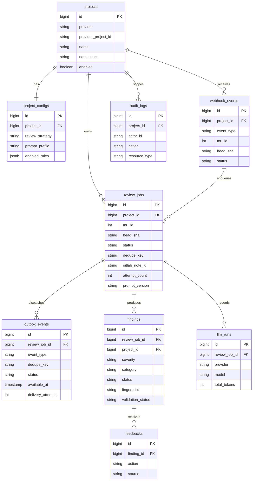

# 数据库与 API 设计

## 1. 设计目标

本文档把总体设计落到可开发的数据库表和接口清单。第一版只覆盖 GitLab MR 审查的最小闭环：

```text
GitLab Webhook
-> ReviewJob
-> ContextPack
-> LLM Review
-> Finding
-> MR 汇总评论
-> Read API
```

第一版优先保证：

- 多项目可区分
- Webhook 可幂等
- 审查记录可追踪
- Finding 可结构化查询
- Read API 可以查询，Dashboard 在 M4 消费稳定 Read Model
- 后期可以补配置编辑、行级评论和反馈闭环

## 2. 表清单

MVP 必做表：

| 表名 | 用途 | MVP |
|---|---|---|
| `projects` | GitLab 项目映射 | 必做 |
| `project_configs` | 项目审查配置 | 必做 |
| `webhook_events` | Webhook 接收与排查记录 | 必做 |
| `review_jobs` | 一次 MR 审查任务 | 必做 |
| `outbox_events` | ReviewJob 可靠投递事件 | 必做 |
| `findings` | 单条结构化审查问题 | 必做 |
| `feedbacks` | 人工反馈记录 | 可后置 |
| `llm_runs` | 模型、Prompt、成本、耗时和错误记录 | 必做 |
| `audit_logs` | 管理操作和 GitLab 写操作审计 | 二期必做 |

## 3. 通用约定

### 3.1 时间字段

所有核心表统一使用：

```text
created_at TIMESTAMPTZ NOT NULL DEFAULT now()
updated_at TIMESTAMPTZ NOT NULL DEFAULT now()
```

事件类表可以只保留 `received_at` 或 `created_at`。

### 3.2 幂等键

Webhook 自动审查任务幂等键：

```text
provider + provider_project_id + mr_iid + head_sha
```

落库时建议生成：

```text
dedupe_key = "{provider}:{provider_project_id}:mr:{mr_iid}:{head_sha}"
```

人工重跑使用调用方 `Idempotency-Key` 或服务端生成的 rerun ID 追加后缀，不与 Webhook 自动任务共用幂等键。

### 3.3 枚举值

`review_jobs.status`：

```text
queued | running | succeeded | failed | skipped
```

`findings.severity`：

```text
critical | high | medium | low | info
```

`findings.status`：

```text
open | resolved | ignored | false_positive
```

`feedbacks.action`：

```text
accepted | fixed | ignored | false_positive | comment
```

`findings.validation_status`：

```text
valid | rejected | needs_review
```

### 3.4 主键与外键

- 内部主键统一使用 `BIGINT`，不向 GitLab 暴露数据库序列含义。
- 核心外键默认禁止级联删除，项目删除通过显式数据保留流程处理。
- API 中 ID 使用十进制字符串或整数，前后端不得依赖 ID 连续性。
- `provider_project_id`、`mr_iid`、SHA 和 GitLab Note ID 保留原始平台值。

### 3.5 错误信息

- 数据库只保存脱敏后的 `error_code/error_message`。
- Provider 原始响应、Token、完整 Prompt、diff 和代码内容不能写入错误字段。
- 可重试错误与永久错误必须使用稳定错误码区分。

## 4. 数据库表字段

### 4.1 projects

保存已接入的 GitLab 项目。Webhook 进入系统后，先通过 `provider + provider_project_id` 定位项目。

| 字段 | 类型 | 约束 | 说明 |
|---|---|---|---|
| `id` | `BIGSERIAL` | PK | 内部项目 ID |
| `provider` | `VARCHAR(32)` | NOT NULL | Git 平台，MVP 固定为 `gitlab` |
| `provider_project_id` | `VARCHAR(128)` | NOT NULL | GitLab 项目 ID |
| `name` | `VARCHAR(255)` | NOT NULL | 项目名称 |
| `namespace` | `VARCHAR(255)` | NULL | GitLab namespace，例如 `seakoi/design` |
| `repository_url` | `TEXT` | NOT NULL | clone 或 http 仓库地址 |
| `web_url` | `TEXT` | NULL | GitLab 项目页面地址 |
| `default_branch` | `VARCHAR(255)` | NULL | 默认分支 |
| `enabled` | `BOOLEAN` | NOT NULL DEFAULT TRUE | 是否启用审查 |
| `webhook_secret_ref` | `VARCHAR(255)` | NOT NULL | Webhook Secret Manager 引用 |
| `git_token_ref` | `VARCHAR(255)` | NOT NULL | 最小权限 GitLab Token 引用 |
| `created_at` | `TIMESTAMPTZ` | NOT NULL | 创建时间 |
| `updated_at` | `TIMESTAMPTZ` | NOT NULL | 更新时间 |

索引：

```sql
UNIQUE (provider, provider_project_id)
INDEX (enabled)
```

### 4.2 project_configs

保存项目级审查配置。MVP 可以通过种子数据或配置文件初始化，Dashboard 第一版只读展示。

| 字段 | 类型 | 约束 | 说明 |
|---|---|---|---|
| `id` | `BIGSERIAL` | PK | 配置 ID |
| `project_id` | `BIGINT` | FK, UNIQUE, NOT NULL | 关联 `projects.id` |
| `review_enabled` | `BOOLEAN` | NOT NULL DEFAULT TRUE | 是否启用 MR 审查 |
| `review_strategy` | `VARCHAR(32)` | NOT NULL DEFAULT `simple_context` | 审查策略 |
| `prompt_profile` | `VARCHAR(64)` | NOT NULL DEFAULT `default` | Prompt 配置名 |
| `config_version` | `INTEGER` | NOT NULL DEFAULT 1 | 配置版本，变更时递增 |
| `llm_provider` | `VARCHAR(64)` | NULL | 项目级模型供应商，空则用系统默认 |
| `llm_model` | `VARCHAR(128)` | NULL | 项目级模型名 |
| `llm_credential_ref` | `VARCHAR(255)` | NULL | 模型凭据引用，通常由网关统一提供 |
| `data_policy` | `VARCHAR(32)` | NOT NULL DEFAULT `internal_only` | 代码数据出域策略 |
| `supported_extensions` | `TEXT[]` | NOT NULL | 支持审查的文件后缀 |
| `ignore_paths` | `JSONB` | NOT NULL DEFAULT `[]` | 忽略路径 |
| `enabled_rules` | `JSONB` | NOT NULL DEFAULT `[]` | 启用规则 |
| `path_rules` | `JSONB` | NOT NULL DEFAULT `{}` | 路径级规则 |
| `max_input_tokens` | `INTEGER` | NOT NULL DEFAULT 30000 | 单次审查输入 Token 上限 |
| `min_confidence` | `INTEGER` | NOT NULL DEFAULT 70 | GitLab 回写的最低置信度 |
| `created_at` | `TIMESTAMPTZ` | NOT NULL | 创建时间 |
| `updated_at` | `TIMESTAMPTZ` | NOT NULL | 更新时间 |

索引：

```sql
UNIQUE (project_id)
```

### 4.3 webhook_events

保存 GitLab Webhook 原始事件和处理状态，方便排查重复触发、解析失败和 GitLab payload 变化。

| 字段 | 类型 | 约束 | 说明 |
|---|---|---|---|
| `id` | `BIGSERIAL` | PK | 事件 ID |
| `project_id` | `BIGINT` | FK, NULL | 已识别项目，识别失败时为空 |
| `provider` | `VARCHAR(32)` | NOT NULL | MVP 为 `gitlab` |
| `provider_project_id` | `VARCHAR(128)` | NULL | GitLab 项目 ID |
| `event_type` | `VARCHAR(64)` | NOT NULL | 例如 `merge_request` |
| `delivery_id` | `VARCHAR(255)` | NULL | GitLab 事件唯一 ID，若请求头提供 |
| `mr_iid` | `INTEGER` | NULL | MR IID |
| `head_sha` | `VARCHAR(64)` | NULL | MR head sha |
| `status` | `VARCHAR(32)` | NOT NULL | `received`、`enqueued`、`ignored`、`failed` |
| `payload` | `JSONB` | NOT NULL | 脱敏 Payload，并按安全策略设置保留期 |
| `error_message` | `TEXT` | NULL | 失败原因 |
| `received_at` | `TIMESTAMPTZ` | NOT NULL DEFAULT now() | 接收时间 |

索引：

```sql
INDEX (project_id, received_at DESC)
INDEX (provider, provider_project_id)
INDEX (event_type, received_at DESC)
UNIQUE (delivery_id) WHERE delivery_id IS NOT NULL
```

### 4.4 review_jobs

保存一次 MR 审查任务。一个 MR 每个 `head_sha` 最多产生一个 Webhook 自动任务；二期允许创建显式人工重跑任务。

| 字段 | 类型 | 约束 | 说明 |
|---|---|---|---|
| `id` | `BIGSERIAL` | PK | 审查任务 ID |
| `project_id` | `BIGINT` | FK, NOT NULL | 关联项目 |
| `webhook_event_id` | `BIGINT` | FK, NULL | 来源 webhook 事件 |
| `trigger_type` | `VARCHAR(32)` | NOT NULL DEFAULT `webhook` | `webhook` 或 `manual_rerun` |
| `parent_review_job_id` | `BIGINT` | FK, NULL | 人工重跑关联的原任务 |
| `provider_project_id` | `VARCHAR(128)` | NOT NULL | 冗余 GitLab 项目 ID，便于回写 |
| `mr_iid` | `INTEGER` | NOT NULL | MR IID |
| `mr_title` | `TEXT` | NULL | MR 标题 |
| `mr_url` | `TEXT` | NULL | MR 页面地址 |
| `source_branch` | `VARCHAR(255)` | NULL | 源分支 |
| `target_branch` | `VARCHAR(255)` | NULL | 目标分支 |
| `base_sha` | `VARCHAR(64)` | NULL | base sha |
| `start_sha` | `VARCHAR(64)` | NULL | start sha |
| `head_sha` | `VARCHAR(64)` | NOT NULL | 当前 MR head sha |
| `author_username` | `VARCHAR(255)` | NULL | MR 作者 |
| `status` | `VARCHAR(32)` | NOT NULL | 任务状态 |
| `dedupe_key` | `VARCHAR(512)` | NOT NULL | 幂等键 |
| `review_strategy` | `VARCHAR(32)` | NOT NULL | 本次实际使用的策略 |
| `prompt_profile` | `VARCHAR(64)` | NOT NULL | 本次 Prompt Profile |
| `prompt_version` | `VARCHAR(64)` | NOT NULL | 可复现的 Prompt 版本 |
| `result_schema_version` | `VARCHAR(32)` | NOT NULL | 结构化输出 Schema 版本 |
| `config_snapshot` | `JSONB` | NOT NULL | 去除 Secret 后的项目配置快照 |
| `attempt_count` | `INTEGER` | NOT NULL DEFAULT 0 | 已执行次数 |
| `max_attempts` | `INTEGER` | NOT NULL DEFAULT 3 | 最大执行次数 |
| `next_retry_at` | `TIMESTAMPTZ` | NULL | 下次允许重试时间 |
| `changed_files_count` | `INTEGER` | NOT NULL DEFAULT 0 | 变更文件数 |
| `context_files_count` | `INTEGER` | NOT NULL DEFAULT 0 | 实际进入上下文的文件数 |
| `skipped_files_count` | `INTEGER` | NOT NULL DEFAULT 0 | 因规则、类型或预算跳过的文件数 |
| `additions` | `INTEGER` | NOT NULL DEFAULT 0 | 新增行数 |
| `deletions` | `INTEGER` | NOT NULL DEFAULT 0 | 删除行数 |
| `summary` | `TEXT` | NULL | 审查摘要 |
| `markdown_result` | `TEXT` | NULL | 回写 MR 的 Markdown 内容 |
| `gitlab_note_id` | `VARCHAR(128)` | NULL | GitLab 汇总评论 ID |
| `error_code` | `VARCHAR(64)` | NULL | 稳定、可聚合的错误码 |
| `error_message` | `TEXT` | NULL | 脱敏失败原因 |
| `heartbeat_at` | `TIMESTAMPTZ` | NULL | Worker 任务心跳时间 |
| `started_at` | `TIMESTAMPTZ` | NULL | 开始时间 |
| `finished_at` | `TIMESTAMPTZ` | NULL | 结束时间 |
| `created_at` | `TIMESTAMPTZ` | NOT NULL | 创建时间 |
| `updated_at` | `TIMESTAMPTZ` | NOT NULL | 更新时间 |

索引：

```sql
UNIQUE (dedupe_key)
UNIQUE (project_id, mr_iid, head_sha) WHERE trigger_type = 'webhook'
INDEX (project_id, created_at DESC)
INDEX (project_id, status)
INDEX (mr_iid)
INDEX (status, next_retry_at)
```

### 4.4.1 outbox_events

保存需要可靠投递到 Redis/RQ 的任务事件。API 在创建 ReviewJob 的同一事务中写入 Outbox；Dispatcher 是唯一 Redis 生产者。

| 字段 | 类型 | 约束 | 说明 |
|---|---|---|---|
| `id` | `BIGSERIAL` | PK | Outbox 事件 ID |
| `review_job_id` | `BIGINT` | FK, NOT NULL | 关联审查任务 |
| `event_type` | `VARCHAR(64)` | NOT NULL | MVP 固定为 `review_job.queued` |
| `dedupe_key` | `VARCHAR(255)` | UNIQUE, NOT NULL | `review-job:{id}:attempt:{n}` |
| `payload` | `JSONB` | NOT NULL | 仅包含 `review_job_id` |
| `status` | `VARCHAR(32)` | NOT NULL | `pending`、`publishing`、`published` |
| `available_at` | `TIMESTAMPTZ` | NOT NULL | 允许投递时间 |
| `delivery_attempts` | `INTEGER` | NOT NULL DEFAULT 0 | Dispatcher 投递次数 |
| `locked_at` | `TIMESTAMPTZ` | NULL | Dispatcher 原子领取时间 |
| `published_at` | `TIMESTAMPTZ` | NULL | 最近一次成功投递时间 |
| `last_error` | `TEXT` | NULL | 脱敏投递错误 |
| `created_at` | `TIMESTAMPTZ` | NOT NULL | 创建时间 |
| `updated_at` | `TIMESTAMPTZ` | NOT NULL | 更新时间 |

索引：

```sql
UNIQUE (dedupe_key)
INDEX (status, available_at)
INDEX (review_job_id, created_at)
```

`publishing` 超过领取超时时间会恢复为 `pending`。即使 Dispatcher 在 Redis 写入成功后、Outbox 更新前崩溃而造成重复投递，Worker 的原子状态抢占仍保证业务副作用只执行一次。

### 4.5 findings

保存模型审查后的结构化问题。Dashboard、MR 评论渲染和后续反馈闭环都基于该表。

| 字段 | 类型 | 约束 | 说明 |
|---|---|---|---|
| `id` | `BIGSERIAL` | PK | Finding ID |
| `review_job_id` | `BIGINT` | FK, NOT NULL | 关联审查任务 |
| `project_id` | `BIGINT` | FK, NOT NULL | 冗余项目 ID，便于查询 |
| `mr_iid` | `INTEGER` | NOT NULL | MR IID |
| `head_sha` | `VARCHAR(64)` | NOT NULL | 对应 commit sha |
| `severity` | `VARCHAR(32)` | NOT NULL | 严重级别 |
| `category` | `VARCHAR(64)` | NOT NULL | 问题分类 |
| `rule_id` | `VARCHAR(128)` | NULL | 命中的规则 ID |
| `file_path` | `TEXT` | NULL | 文件路径 |
| `line_start` | `INTEGER` | NULL | 起始行 |
| `line_end` | `INTEGER` | NULL | 结束行 |
| `title` | `VARCHAR(255)` | NOT NULL | 问题标题 |
| `description` | `TEXT` | NOT NULL | 问题描述 |
| `evidence` | `TEXT` | NULL | 证据 |
| `suggestion` | `TEXT` | NULL | 修复建议 |
| `confidence` | `INTEGER` | NOT NULL DEFAULT 70 | 置信度，0 到 100 |
| `fingerprint` | `VARCHAR(128)` | NOT NULL | 归一化问题指纹 |
| `validation_status` | `VARCHAR(32)` | NOT NULL | Verifier 结果 |
| `validation_message` | `TEXT` | NULL | 脱敏校验失败原因 |
| `source_pass` | `VARCHAR(64)` | NOT NULL DEFAULT `review` | 产生问题的批次或 Pass |
| `status` | `VARCHAR(32)` | NOT NULL DEFAULT `open` | 状态 |
| `gitlab_discussion_id` | `VARCHAR(255)` | NULL | 二期行级评论使用 |
| `gitlab_note_id` | `VARCHAR(128)` | NULL | 关联 GitLab 评论 |
| `created_at` | `TIMESTAMPTZ` | NOT NULL | 创建时间 |
| `updated_at` | `TIMESTAMPTZ` | NOT NULL | 更新时间 |

索引：

```sql
INDEX (review_job_id)
INDEX (project_id, status)
INDEX (project_id, severity)
INDEX (project_id, mr_iid, head_sha)
INDEX (file_path)
UNIQUE (review_job_id, fingerprint)
```

### 4.6 feedbacks

保存人工反馈。MVP 可以先不开放写接口，但表结构可以预留。

| 字段 | 类型 | 约束 | 说明 |
|---|---|---|---|
| `id` | `BIGSERIAL` | PK | 反馈 ID |
| `finding_id` | `BIGINT` | FK, NOT NULL | 关联 Finding |
| `project_id` | `BIGINT` | FK, NOT NULL | 冗余项目 ID |
| `action` | `VARCHAR(32)` | NOT NULL | 反馈动作 |
| `source` | `VARCHAR(32)` | NOT NULL | `dashboard` 或 `gitlab` |
| `author_username` | `VARCHAR(255)` | NULL | 反馈人 |
| `comment` | `TEXT` | NULL | 备注 |
| `created_at` | `TIMESTAMPTZ` | NOT NULL DEFAULT now() | 创建时间 |

索引：

```sql
INDEX (finding_id)
INDEX (project_id, created_at DESC)
INDEX (action)
```

### 4.7 llm_runs

记录每次模型调用，用于问题排查、质量回归、成本、耗时和失败率统计。该表是 MVP 可观测性的必要部分。

| 字段 | 类型 | 约束 | 说明 |
|---|---|---|---|
| `id` | `BIGSERIAL` | PK | 调用 ID |
| `review_job_id` | `BIGINT` | FK, NOT NULL | 关联审查任务 |
| `stage` | `VARCHAR(64)` | NOT NULL | `review`、`verifier`、`summary` |
| `provider` | `VARCHAR(64)` | NOT NULL | 模型供应商 |
| `model` | `VARCHAR(128)` | NOT NULL | 模型名称 |
| `prompt_profile` | `VARCHAR(64)` | NOT NULL | Prompt Profile |
| `prompt_version` | `VARCHAR(64)` | NOT NULL | Prompt 版本 |
| `request_hash` | `VARCHAR(128)` | NULL | 脱敏请求内容哈希 |
| `attempt_no` | `INTEGER` | NOT NULL DEFAULT 1 | 同一阶段调用次数 |
| `prompt_tokens` | `INTEGER` | NULL | 输入 token |
| `completion_tokens` | `INTEGER` | NULL | 输出 token |
| `total_tokens` | `INTEGER` | NULL | 总 token |
| `duration_ms` | `INTEGER` | NULL | 耗时 |
| `status` | `VARCHAR(32)` | NOT NULL | `succeeded` 或 `failed` |
| `error_code` | `VARCHAR(64)` | NULL | 稳定错误码 |
| `error_message` | `TEXT` | NULL | 脱敏失败原因 |
| `created_at` | `TIMESTAMPTZ` | NOT NULL DEFAULT now() | 创建时间 |

索引：

```sql
INDEX (review_job_id)
INDEX (provider, model)
INDEX (created_at DESC)
```

### 4.8 audit_logs

记录项目配置、任务操作、Finding 状态和 GitLab 写操作。二期开启管理写接口前必须完成。

| 字段 | 类型 | 约束 | 说明 |
|---|---|---|---|
| `id` | `BIGSERIAL` | PK | 审计 ID |
| `project_id` | `BIGINT` | FK, NULL | 项目范围，平台操作可为空 |
| `actor_type` | `VARCHAR(32)` | NOT NULL | `user`、`service`、`system` |
| `actor_id` | `VARCHAR(255)` | NOT NULL | 用户或服务身份 |
| `action` | `VARCHAR(128)` | NOT NULL | 稳定动作名 |
| `resource_type` | `VARCHAR(64)` | NOT NULL | 资源类型 |
| `resource_id` | `VARCHAR(128)` | NULL | 资源 ID |
| `trace_id` | `VARCHAR(64)` | NULL | 调用链 ID |
| `details` | `JSONB` | NOT NULL DEFAULT `{}` | 去除 Secret 后的变更摘要 |
| `created_at` | `TIMESTAMPTZ` | NOT NULL DEFAULT now() | 创建时间 |

索引：

```sql
INDEX (project_id, created_at DESC)
INDEX (actor_id, created_at DESC)
INDEX (resource_type, resource_id)
```

## 5. 关系图



## 6. API 清单

### 6.0 通用约定

- Dashboard API 通过企业 OIDC Bearer Token 认证，Webhook API 只使用项目 Webhook Secret。
- 所有响应包含 `X-Request-ID`；客户端也可以传入该 Header 便于排查。
- 时间使用 ISO 8601 UTC，例如 `2026-07-19T10:00:00Z`。
- 列表接口 MVP 使用 `page/page_size`，`page_size` 最大 100。
- 写接口支持 `Idempotency-Key` 或使用资源版本做并发控制。

统一错误响应：

```json
{
  "error": {
    "code": "PROJECT_NOT_FOUND",
    "message": "Project is not registered",
    "request_id": "req_123",
    "details": {}
  }
}
```

`message/details` 不返回 Secret、代码内容、Provider 原始响应或内部堆栈。

### 6.1 Webhook API

#### POST `/api/webhooks/gitlab`

接收 GitLab Webhook。MVP 只处理 Merge Request Events。

Headers：

| 名称 | 必填 | 说明 |
|---|---|---|
| `X-Gitlab-Event` | 是 | GitLab 事件类型 |
| `X-Gitlab-Token` | 是 | 项目 Webhook Secret，只用于验签 |
| `X-Gitlab-Event-UUID` | 否 | 事件唯一 ID |

处理逻辑：

```text
1. 校验 webhook secret
2. 解析 provider_project_id、mr_iid、head_sha
3. 定位 Project
4. 写入 webhook_events
5. 在数据库唯一约束下创建或获取 ReviewJob
6. 事务提交后入队 `review_job_id`
7. 入队失败时由协调任务扫描 `queued` 状态并补偿
```

响应：

```json
{
  "status": "accepted",
  "review_job_id": 123,
  "deduped": false
}
```

状态码：

| 状态码 | 场景 |
|---|---|
| `202` | 已接收并入队 |
| `200` | 重复事件，已跳过 |
| `400` | payload 不合法 |
| `401` | secret 校验失败 |
| `404` | 项目未接入 |
| `413` | 请求体超过限制 |
| `429` | 项目触发频率超过限制 |

### 6.2 Dashboard 只读 API

#### GET `/api/projects`

查询项目列表。

Query：

| 参数 | 类型 | 说明 |
|---|---|---|
| `enabled` | `boolean` | 是否启用 |
| `keyword` | `string` | 按名称或 namespace 搜索 |
| `page` | `integer` | 页码 |
| `page_size` | `integer` | 每页数量 |

响应：

```json
{
  "items": [
    {
      "id": 1,
      "provider": "gitlab",
      "provider_project_id": "123",
      "name": "design",
      "namespace": "seakoi/design",
      "enabled": true,
      "last_review_at": "2026-07-19T10:00:00Z"
    }
  ],
  "total": 1
}
```

#### GET `/api/projects/{project_id}`

查询项目详情和只读配置。

响应：

```json
{
  "id": 1,
  "provider": "gitlab",
  "provider_project_id": "123",
  "name": "design",
  "namespace": "seakoi/design",
  "repository_url": "https://gitlab.example.com/seakoi/design.git",
  "config": {
    "review_enabled": true,
    "review_strategy": "simple_context",
    "prompt_profile": "default",
    "supported_extensions": [".ts", ".tsx", ".js", ".jsx", ".md"],
    "enabled_rules": ["component-api-compatibility", "react-hooks-safety"]
  }
}
```

#### GET `/api/reviews`

查询审查任务列表。

Query：

| 参数 | 类型 | 说明 |
|---|---|---|
| `project_id` | `integer` | 项目 ID |
| `status` | `string` | 审查状态 |
| `mr_iid` | `integer` | MR IID |
| `author_username` | `string` | 作者 |
| `created_from` | `datetime` | 创建时间起 |
| `created_to` | `datetime` | 创建时间止 |
| `page` | `integer` | 页码 |
| `page_size` | `integer` | 每页数量 |

响应：

```json
{
  "items": [
    {
      "id": 1001,
      "project_id": 1,
      "mr_iid": 45,
      "mr_title": "feat: update button api",
      "head_sha": "abc123",
      "status": "succeeded",
      "findings_count": 3,
      "high_findings_count": 1,
      "created_at": "2026-07-19T10:00:00Z",
      "finished_at": "2026-07-19T10:01:20Z"
    }
  ],
  "total": 1
}
```

#### GET `/api/reviews/{review_id}`

查询审查详情。

响应：

```json
{
  "id": 1001,
  "project_id": 1,
  "mr_iid": 45,
  "mr_url": "https://gitlab.example.com/seakoi/design/-/merge_requests/45",
  "source_branch": "feature/button-api",
  "target_branch": "master",
  "head_sha": "abc123",
  "status": "succeeded",
  "summary": "本次变更存在 1 个高风险 API 兼容性问题。",
  "markdown_result": "## AI Review Result...",
  "gitlab_note_id": "9988",
  "changed_files_count": 5,
  "additions": 120,
  "deletions": 30
}
```

#### GET `/api/reviews/{review_id}/findings`

查询某次审查产生的 Finding 列表。

响应：

```json
{
  "items": [
    {
      "id": 5001,
      "severity": "high",
      "category": "api_compatibility",
      "file_path": "packages/elements/src/button/index.tsx",
      "line_start": 42,
      "title": "Button props 删除了已发布字段",
      "status": "open"
    }
  ]
}
```

#### GET `/api/findings`

跨审查查询 Finding。

Query：

| 参数 | 类型 | 说明 |
|---|---|---|
| `project_id` | `integer` | 项目 ID |
| `review_job_id` | `integer` | 审查任务 ID |
| `severity` | `string` | 严重级别 |
| `status` | `string` | 状态 |
| `category` | `string` | 分类 |
| `file_path` | `string` | 文件路径 |
| `page` | `integer` | 页码 |
| `page_size` | `integer` | 每页数量 |

#### GET `/api/findings/{finding_id}`

查询 Finding 详情。

响应：

```json
{
  "id": 5001,
  "review_job_id": 1001,
  "project_id": 1,
  "severity": "high",
  "category": "api_compatibility",
  "file_path": "packages/elements/src/button/index.tsx",
  "line_start": 42,
  "line_end": 45,
  "title": "Button props 删除了已发布字段",
  "description": "已发布组件的 props 字段被删除，可能导致调用方编译失败。",
  "evidence": "diff 中删除了 ButtonProps.xxx 字段。",
  "suggestion": "保留旧字段并标记 deprecated，或提供迁移说明。",
  "confidence": 85,
  "status": "open"
}
```

#### GET `/api/metrics/overview`

查询全局概览。

响应：

```json
{
  "projects_count": 4,
  "reviews_count": 120,
  "succeeded_reviews_count": 110,
  "failed_reviews_count": 10,
  "open_findings_count": 36,
  "high_findings_count": 8,
  "avg_review_duration_ms": 68000
}
```

#### GET `/api/metrics/projects/{project_id}`

查询项目维度统计。

响应：

```json
{
  "project_id": 1,
  "reviews_count": 30,
  "open_findings_count": 12,
  "false_positive_count": 2,
  "avg_review_duration_ms": 72000,
  "top_categories": [
    {
      "category": "api_compatibility",
      "count": 6
    }
  ]
}
```

### 6.3 二期写接口

以下接口不建议放进 MVP，等 Dashboard 只读能力稳定后再开放。

#### PATCH `/api/findings/{finding_id}/status`

更新 Finding 状态，并写入 `feedbacks`。

请求：

```json
{
  "status": "false_positive",
  "comment": "该字段尚未正式发布，不算 breaking change。"
}
```

要求：

- 必须具有 `review_operator` 或更高角色。
- Finding 状态和 `feedbacks` 在同一事务中写入。
- 同时生成 `audit_logs` 记录。

#### POST `/api/reviews/{review_id}/rerun`

重新执行一次审查。创建 `trigger_type=manual_rerun` 的新任务，保存 `parent_review_job_id`，并使用新的显式 rerun 幂等键；需要限制权限和频率。

#### PATCH `/api/projects/{project_id}/config`

更新项目配置。请求必须携带当前 `config_version`，避免并发覆盖；响应返回递增后的版本并写审计日志。

## 7. MR 评论回写说明

MR 评论回写不是前端 API，而是 Worker 调用 GitLab API 完成。

MVP 使用汇总评论：

```text
POST /api/v4/projects/{provider_project_id}/merge_requests/{mr_iid}/notes
```

回写内容由 `review_jobs.markdown_result` 生成，来源是结构化 `findings`。

为了避免刷屏：

1. 同一个 `project_id + mr_iid + head_sha` 只创建一个 Webhook 自动 ReviewJob
2. `review_jobs.gitlab_note_id` 保存 GitLab 评论 ID
3. 同一个任务重试时优先更新已有评论
4. 新 commit 产生新的 `head_sha`，允许生成新的审查评论

MVP 评论格式：

```md
## AI Review Result

本次审查发现 3 个问题，其中 1 个高风险问题。

### Findings

1. [high] Button props 删除了已发布字段
   - 文件：packages/elements/src/button/index.tsx:42
   - 影响：可能导致调用方编译失败
   - 建议：保留旧字段并标记 deprecated

详情见 Dashboard：...
```

## 8. 数据保留与删除

- `webhook_events.payload` 默认保留 30 天，生产值由企业策略配置。
- ReviewJob、Finding、Feedback 和 LLM 用量按审计要求保留，不默认永久保存。
- `llm_runs` 不保存完整 Prompt 和模型响应，只保存版本、用量、状态、哈希和脱敏错误。
- 项目删除先禁用接入，再执行异步数据清理；核心外键不使用无条件级联删除。
- 审计日志的保留期和删除权限独立于普通业务数据。

## 9. 实施依据

数据库和 API 的交付顺序、阶段范围及验收标准统一以 [ROADMAP.md](./ROADMAP.md) 为准；安全相关字段和访问控制以 [SECURITY.md](./SECURITY.md) 为准。
