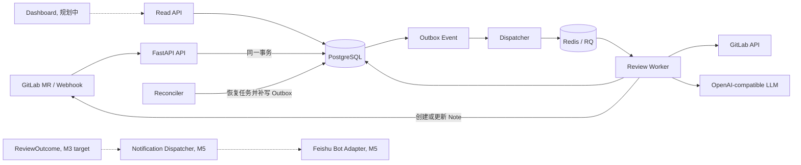
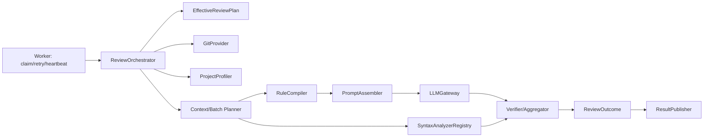
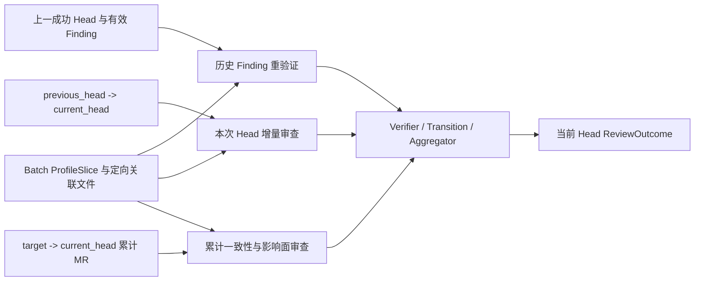

# GitLab MR AI Code Review 设计总览与里程碑计划

> 文档定位：项目设计、当前事实和建设计划的主入口。
>
> 状态基线：2026-08-21，以当前仓库代码、数据库迁移和自动化测试为准。
>
> 状态定义：`功能已实现` 表示已有代码和自动化测试支撑；`系统验收待补` 表示尚未通过对应真实依赖或现场环境验证；`规划中` 表示尚无可运行实现。

## 1. 总体结论

当前项目已经完成私有化 GitLab MR AI Code Review 的最小闭环，以及事务 Outbox、Dispatcher、Redis/RQ、Worker 原子领取和 Reconciler 补偿等可靠投递机制。

项目当前处于：

**M0 至 M2 功能实现完成，M2 隔离依赖和故障矩阵验收已通过；M3.0 至 M3.3.4 的代码与自动化门禁已完成。M3.3.4 已实现 ReviewLineage、当前问题状态账本及关闭旧 MR 后重建新 MR 的受控问题接续。M3 尚未整体完成：M3.3.4 真实重建 MR、真实连续 Head/大 MR 现场复验、种子样本人工裁决、50 个 Golden MR、两个真实项目 Shadow 和质量阈值验收仍待补；受控人工验收可以临时 publish，但在完成门禁前不得扩大 publish 范围。**

现有系统已经能够：

1. 接收、认证、过滤并去重 GitLab Merge Request Webhook。
2. 在同一数据库事务中保存 WebhookEvent、ReviewJob 和 OutboxEvent。
3. 通过 Dispatcher、Redis/RQ 和 Worker 异步执行评审。
4. 拉取 MR、Diff 和变更文件的有限上下文。
5. 调用 OpenAI 兼容模型并解析结构化 Finding。
6. 确定性校验 Finding，保存 Finding 和 LLMRun。
7. 在 GitLab MR 中创建或更新汇总评论。
8. 对重复事件、并发入队、重复 Worker 消息和任务卡死执行幂等或补偿。
9. 通过只读 API 查询项目、任务和 Finding。

当前最重要的问题已经不是“能否调用 LLM”，而是：

- 模型是否真正理解项目结构、框架约定和开发范式。
- 哪些规则对哪些文件生效，是否可解释、可复现、可回滚。
- Prompt 或模型变化后，质量是提升还是退化。
- 大 MR 是否完整覆盖，部分失败是否会被误报为成功。
- 同一 MR 连续提交时，未修复问题是否会因模型漂移消失，修复代码引入的新问题是否会进入评审。
- 真实 Redis、PostgreSQL、GitLab 和进程崩溃下是否仍不丢任务、不重复评论。

因此后续顺序确定为：

**安全可复现基线 -> 最小项目理解 -> 规则与 Prompt 编译 -> 大 MR 分批 -> 质量与系统验收 -> 可观测试点 -> 反馈和企业治理。**

## 2. 产品定位与边界

### 2.1 产品目标

- 面向私有 GitLab 部署，代码和评审数据只进入组织允许的网络和模型边界。
- 自动评审 MR，优先发现正确性、安全性、可靠性和 API 兼容性问题。
- 输出低噪声、可定位、有证据、可执行的建议，而不是风格偏好汇总。
- 支持通用项目接入，同时允许按项目、语言、框架和路径应用不同规则。
- 输出可追溯、可复现、可去重的 Finding 和 GitLab 评论。
- 外部依赖短时异常时可恢复，不能因队列或发布重试产生重复业务结果。

### 2.2 “通用型”的准确含义

通用型不等于对所有文件后缀具有同等评审质量。项目采用两层能力：

1. **通用核心：** GitLab 接入、Diff、任务状态、结构化输出、Verifier、规则契约、Prompt 契约和发布机制与语言无关。
2. **生态画像：** 项目结构、框架惯例、模块边界、测试约定和专项规则按语言或框架逐步验证。

`supported_extensions` 只表示文件能够进入通用评审流程，不代表该语言已经通过质量认证。M3 起维护能力矩阵：

- `validated`：有 Golden Dataset 和真实项目试点数据。
- `experimental`：可使用通用规则，但没有足够质量样本。
- `unsupported`：明确跳过并给出原因。

在 M3 质量基线完成前，不对任何语言宣称已达到生产质量门槛。

### 2.3 核心用户

| 用户 | 首要诉求 | 主要入口 |
|---|---|---|
| 开发者 | 在 MR 中获得少而准、可定位、可操作的意见 | GitLab MR |
| 项目管理员 | 控制项目开关、规则、预算和试点范围 | CLI，后续管理界面 |
| 平台运维/质量负责人 | 排查任务、观察成本、评估质量和治理配置 | Read API，后续 Dashboard |

### 2.4 当前不纳入范围

- 不继续维护或直接迭代原开源项目，原项目只作为迁移参考。
- 暂不支持 GitHub、Gitea、Push 和定时全仓扫描。
- MVP 不将 AI 结果作为强制合并门禁。
- 暂不执行仓库任意脚本，不提供无隔离的 Agent 自主执行。
- 暂不建设向量数据库、全仓 RAG、通用 Symbol Graph 或多 Agent 编排。
- 不替代 GitLab Issue、Jira、SAST 或缺陷管理平台，不承诺维护仓库级“全部缺陷真相”。
- 不按文件路径、行号或相似标题自动合并不同开发者、不同变更意图或不同评审谱系的问题生命周期。

### 2.5 持续问题治理职责

平台必须保证“已经验证的问题不会仅因 LLM 漂移或 MR 窗口重建而消失”，但治理范围限定在同一 `ReviewLineage`：

| 平台负责 | 平台不负责 |
|---|---|
| 保存每个 ReviewJob 的不可变 Finding 发生记录 | 建立全仓库通用缺陷台账 |
| 维护同一评审谱系内问题的当前状态和 Evidence | 把不同谱系的相似问题自动视为同一问题 |
| 根据 Head、规则和内容 Provenance 判定延续或定向复核 | 仅凭文件路径、行号、分支名或语义相似度继承 |
| 将当前开放问题投影到活动 MR Note 并随 Head 更新 | 替代 Issue/Jira 的指派、排期、SLA 和跨团队处置流程 |
| 保留完整 Coverage、Transition 和来源审计 | 将不完整评审或模型漏报解释为问题已解决 |

MR 是开发者查看和处理问题的活动窗口，不是问题状态的唯一数据源。旧 MR 关闭后其 Note 冻结为历史快照；只有新 MR 被安全地关联到原 `ReviewLineage` 时，当前开放问题才投影到新 MR。仓库级相似问题统计属于后期只读关联能力，不参与自动继承、自动解决或发布。

## 3. 当前架构与演进判断

### 3.1 当前运行架构



当前部署采用模块化单体，API、Dispatcher、Worker、Reconciler 是独立进程，共享同一个代码库、领域模型和 PostgreSQL。

该部署架构能够支撑 M3 至 M5，不需要拆微服务。需要调整的是 Worker 内部职责，而不是增加新的网络服务。

### 3.2 当前架构适配性

| 方面 | 判断 | 处理方式 |
|---|---|---|
| 事务与异步投递 | Outbox 和原子领取方向正确 | 保持现状，补真实依赖和崩溃测试 |
| 外部适配器 | GitLabClient、LLM Adapter 已独立成模块 | 补稳定 Port/Protocol，方便组件测试 |
| Worker 职责 | 同时负责配置、GitLab、Context、LLM、存储和发布，继续扩展会失控 | M3 抽出应用级 ReviewOrchestrator，Worker 只保留任务生命周期和重试 |
| 配置快照 | ReviewJob 已保存快照，但 Worker 实际使用当前 ProjectConfig | M3.0 改为快照驱动，禁止旧任务读取可变配置 |
| Rule/Prompt | 配置字段已预留，但无 Rule Compiler；Prompt 硬编码在 LLM Adapter | M3 建立纯函数 Catalog、Compiler 和 PromptAssembler |
| 项目理解 | 只有 Diff 和变更文件新增行附近片段 | M3 增加受控 ProjectProfile 和 ContextManifest |
| 通知渠道 | 当前只有 GitLab Note，没有通用通知边界 | M3 保留 `NotificationPort`，M5 以 Feishu 适配器接入，不把通知逻辑放入 Worker 核心 |
| Dashboard | 当前无 Web，查询 API 也不是完整 Read Model | M4 先稳定 Read Model，再做最小治理界面 |

### 3.3 M3 内部目标边界



职责约束：

- `ReviewOrchestrator` 只编排一次评审，不包含队列和 HTTP 路由。
- `ProjectProfiler` 只读取允许的项目事实和规范，不调用 LLM。
- `Context/Batch Planner` 只选择和分组上下文，不决定是否发布。
- `RuleCompiler` 是确定性纯逻辑，不访问 GitLab、数据库和 LLM。
- `SyntaxAnalyzerRegistry` 只选择平台内置、固定版本的解析器，不执行仓库脚本、安装依赖或访问网络。
- `PromptAssembler` 不访问外部系统，只消费已解析的数据结构。
- `Verifier/Aggregator` 不执行网络 I/O。
- Port 只放在 GitLab、LLM、持久化、发布和通知等外部边界，不为每个内部函数创建接口。

这是一项模块内重构，不新增微服务、消息中间件或通用工作流引擎。

## 4. 技术与数据基线

### 4.1 技术栈

| 层次 | 技术选型 |
|---|---|
| 运行环境 | Python 3.12 |
| API | FastAPI、Pydantic、Uvicorn |
| 数据访问 | SQLAlchemy 2、Alembic |
| 数据库 | PostgreSQL 16 |
| 队列 | Redis 7、RQ |
| HTTP 客户端 | HTTPX |
| LLM 接入 | OpenAI-compatible Chat Completions API |
| 部署 | Docker Compose，独立 API/Dispatcher/Worker/Reconciler 进程 |
| 测试与质量 | Pytest、Ruff |

### 4.2 当前数据模型

当前共有 9 张业务表，不包含 Alembic 版本表：

| 表 | 作用 | 主要关系 |
|---|---|---|
| `projects` | GitLab 项目和凭据引用 | 1:N 关联配置、Webhook、任务 |
| `project_configs` | 项目当前配置 | N:1 关联项目 |
| `webhook_events` | Webhook 去重和审计信息 | N:1 关联项目，1:N 关联任务 |
| `review_jobs` | 一次 MR 评审任务及状态机 | N:1 关联项目和事件，1:N 关联运行数据 |
| `outbox_events` | 可靠投递事件 | N:1 关联 ReviewJob |
| `findings` | 结构化问题和稳定指纹 | N:1 关联 ReviewJob |
| `llm_runs` | 模型、请求哈希、耗时、Token 和错误 | N:1 关联 ReviewJob |
| `review_lineages` | 可证明连续的一次变更谱系 | N:1 关联项目，1:N 关联 ReviewJob |
| `lineage_finding_states` | 谱系内已验证问题的当前投影 | N:1 关联 ReviewLineage；指向首次/最近任务和最近 Finding |

M3.0 已在 `review_jobs.effective_plan` 保存不可变 EffectiveReviewPlan，并用 `plan_hash` 校验内容；`config_snapshot` 保留为原始配置审计。当前不建立 Prompt/Rule Registry 数据库表，只有管理界面和独立批次恢复成为真实需求时，才增加相应表。

M3.3.4 已在原有 7 张业务表基础上增加两个最小状态表，并为 `review_jobs` 增加可空 `review_lineage_id`：

| 目标表 | 作用 | 唯一性与边界 |
|---|---|---|
| `review_lineages` | 标识可跨 MR 延续的一次代码变更意图 | 属于单一 Project；不能只由分支名决定 |
| `lineage_finding_states` | 保存谱系内已验证问题的当前投影 | `review_lineage_id + fingerprint` 唯一；文件位置只是 Evidence 属性 |

`findings` 继续保存每次 ReviewJob 的不可变 Occurrence，不被账本覆盖或改写。`lineage_finding_states` 只保存 `open | resolved | uncertain | not_applicable` 当前状态、首次/最近来源 Job、最近验证 Head 和必要的规则/Evidence/Provenance，不复制完整模型响应；评论发布状态继续归 ReviewJob。两张表不组成通用事件溯源或仓库级缺陷管理系统。

## 5. 当前实现盘点

### 5.1 已实现能力

#### 私有化和工程运行基线

- 项目与参考开源实现解耦，按私有化平台独立演进。
- 全项目使用 Python 3.12。
- 提供 Docker Compose 和 Alembic 迁移。
- API、Dispatcher、Worker、Reconciler 可独立部署。
- 凭据通过环境变量或文件引用注入。

#### GitLab 接入

- CLI 注册和查询 GitLab 项目。
- 校验 Webhook Secret、事件类型和请求体大小。
- 忽略 Draft MR 和不支持的 MR 动作。
- 持久化脱敏 Payload，不保存请求头 Secret。
- 按 Delivery ID 和项目、MR IID、Head SHA 组合去重。
- 支持 TLS、自签名 CA、超时、限次重试和 Retry-After。
- 拉取 MR、Changes、Diff 和必要文件内容。

#### 评审引擎

- 解析 Diff 新增行，按扩展名、忽略路径、风险和字符预算筛选。
- 支持 `simple_context` 和 `diff_only`。
- 固定系统 Prompt 和结构化 JSON 输出。
- 解析失败时允许一次只修复格式的请求。
- 校验文件、置信度、新增行和字面证据。
- 生成 Fingerprint 并过滤单任务重复问题。
- 保存 Finding、LLMRun、结果、错误和 Token 使用量。
- 创建或更新带稳定标记的 GitLab 汇总 Note。
- 在任务创建时冻结 EffectiveReviewPlan，旧任务和重试不读取可变 ProjectConfig 决定行为。
- 使用版本化 Prompt Envelope，完整请求体生成 SHA-256 请求哈希；Repair 请求独立记录哈希。
- 支持 `publish`/`shadow`，Shadow 保存结果但不调用 GitLab Writer。
- GitLab 发布前再次检查 MR Head，变化时以 `STALE_HEAD_BEFORE_PUBLISH` 跳过旧结果。
- 已抽取可用 Fake Model Port 测试的轻量 `ReviewOrchestrator`。
- 从目标分支构建 ProjectProfile，按版本化 Rule Catalog 编译项目和路径级规则。
- 对 TS/TSX、Python、JSON、YAML 执行固定版本确定性语法分析。
- GitLab `/changes` overflow 时分页恢复 `/diffs`；未恢复完整时保存稳定失败原因。
- 大 MR 在单 ReviewJob 内稳定分批，按单批输入、批次数、总输入、总调用和总耗时限制执行。
- 批次文件先标记 `pending`，只有成功批次计入 reviewed；单批永久失败时继续后续批次并汇总 partial。
- 每次真实 LLM HTTP 尝试独立记录 Batch Key、Job Attempt、Call、Request Hash、耗时、Token 和错误。

#### 可靠性和查询

- API 事务写入 `WebhookEvent + ReviewJob + OutboxEvent`。
- Dispatcher 数据库领取和 Redis 短时投递锁。
- Worker 原子领取，重复队列消息不能并发执行同一任务。
- Reconciler 恢复超时 running，并补偿超过宽限期的 queued。
- Note 写入失败后可以复用已保存 Markdown，只重试发布阶段。
- 健康检查、项目、ReviewJob 和 Finding 只读 API。
- 生产模式下使用独立 `API_BEARER_TOKEN` 保护查询 API。

### 5.2 已知事实缺口

| 能力 | 当前事实 | 风险 |
|---|---|---|
| 配置快照 | M3.0 已冻结 EffectiveReviewPlan 并校验 Plan Hash | 旧历史任务无 Plan 时只允许从自身快照一次性补建 |
| Prompt 版本 | M3.0 已使用版本化 Prompt Envelope 和完整请求哈希 | 尚无 Prompt Catalog 发布、回滚和离线质量门禁 |
| 规则 | M3.2 已执行版本化 Catalog、路径规则、可信仓库覆盖和 Verifier `rule_id/scope` 校验 | 尚无 50 个已裁决 MR 的跨项目质量证据 |
| 项目理解 | M3.1 已从目标分支构建 ProjectProfile 并选择相关文件 | 真实项目配置效果和框架范式识别仍需 Shadow 人工验收 |
| 跨 Head 一致性 | 每个新 Head 会重新审查累计 MR，但尚未消费上一成功 Head 的有效 Finding | 未修改问题可能因模型输出漂移在新评论中消失；修复增量缺少独立标识和定向复核 |
| 上下文充分度 | 已统计 eligible、reviewed、incomplete 和策略排除文件 | ProjectProfile 字符预算或 Tree 截断仍可能与代码覆盖混在同一提示中，零 Finding 结论容易被误读为完整证明 |
| Head 校验 | LLM 前和发布前各校验一次 | GitLab Staging 的快速连续 Push 契约仍需现场验证 |
| Note 生命周期 | Marker 包含 Job 和 Head，每个新 Head 默认产生新 Note | 连续 Push 可能造成 MR 评论噪声 |
| Token 预算 | 使用字符数除以 4 的估算 | 不同模型偏差较大，只能作为保守预算 |
| 语言质量 | 支持多个扩展名 | 尚无按语言划分的质量基线 |

### 5.3 当前测试证据边界

基础 Pytest 测试已通过，覆盖 Webhook、API 去重、API/Reconciler 竞态、Worker 原子领取和心跳、Outbox、Redis 锁 Fake、LLM JSON 修复、GitLab Note Mock、Context 和 Verifier 基础行为。新增的 M2 集成套件使用独立 PostgreSQL 16 和 Redis 7，覆盖 20 并发 Webhook、双 Dispatcher、双 Worker、Redis 丢失/锁过期、Dispatcher 崩溃、Worker 四阶段崩溃和 Note POST 响应超时。

基础测试仍使用 SQLite、Mock 或 Fake；M2 集成套件已覆盖以下真实依赖和故障注入边界：

- PostgreSQL `FOR UPDATE SKIP LOCKED` 并发语义。
- 真实 Redis/RQ、锁过期、RQ Job 丢失和 Redis 清空恢复。
- 多 Dispatcher、多 Worker 和进程崩溃点。
- GitLab Note POST 成功后超时的 Mock 契约；GitLab Staging 的分页、限流、CA 和真实网络契约仍待现场验证。

M3.0 至 M3.3.2 自动化测试还覆盖了配置冻结、Plan/Prompt Hash 稳定性、Prompt Injection 信任边界、ProjectProfile、仓库文件范围覆盖、中文输出与 Repair、规则编译、确定性语法分析、GitLab overflow 分页、稳定 Batch/Segment Key、完整 eligible workset、超长 Diff hunk 分段、Repair/重试预算、逐次 LLMRun 审计、中间批次失败继续、跨批聚合、跨 Head 父任务谱系、Compare Delta、历史 Finding 延续/解决/无法确认、ProfileSlice 和双维 Coverage。测试数量以每次全量门禁输出为准；隔离 PostgreSQL 16/Redis 7 历史门禁为 10 passed。

真实 GitLab Shadow 已用一个含受支持代码的 MR 验证 Webhook、GitLab 拉取、LLM、Finding 持久化和零 Writer 调用，并发现过 Evidence 包装误拒绝。M3.0.1 已用 Evidence v2、稳定拒绝码和 MR `!32` Fixture 修复该问题，真实 Shadow 复验仍待人工触发。M3.1 已提供 12 个 synthetic `pending_human` 种子样本和评测 CLI，但它们尚未构成 Golden Dataset。仍未覆盖：按语言质量回归、多项目 Shadow 样本和企业网络完整现场契约。

真实同一 MR 连续 Head 还发现：上一 Head 的两个 valid Finding 所在文件在新 Head 中内容哈希未变化，新任务也完整执行了两个 Batch，但模型没有再次输出原问题，最终评论显示零 Finding。这一事实已转化为 M3.3.2 自动化回归；代码会确定性延续内容、规则和关联依赖均未变化的问题，变化项必须定向复核。真实连续 Head Shadow 尚未完成，因此暂不扩大 publish 范围。

因此 M0 至 M2 的准确状态是“功能实现完成；M2 隔离依赖验收通过，M1 的企业 GitLab Staging 现场验收和 M0 发布治理仍待补”。

## 6. 里程碑总览

| 里程碑 | 当前状态 | 核心目标 | 退出条件摘要 |
|---|---|---|---|
| M0 私有化运行基线 | 功能已实现，治理待补 | 统一运行时、存储、部署和配置 | CI、许可证、内部 CA 和发布治理在试点前补齐 |
| M1 最小评审闭环 | 功能已实现，系统验收待补 | Webhook 到 GitLab 评论可用 | 真实 GitLab Staging 契约通过 |
| M2 可靠投递与幂等 | 功能已实现，隔离依赖验收通过 | 至少一次投递下不丢任务、不重复业务结果 | PostgreSQL/Redis/崩溃矩阵已通过；生产容量和现场网络仍需验证 |
| M3 项目理解和质量基线 | M3.0 至 M3.3.4 代码和自动化完成；系统验收待补 | 可复现计划、项目画像、规则 Prompt、大 MR、跨 Head/重建 MR 一致性和评测 | 谱系账本及连续 Head 真实 Shadow 通过，两个试点生态通过离线及 Shadow 门禁 |
| M4 可观测试点 | 规划中 | 真实项目持续运行且可诊断、可度量 | 至少 14 天和 100 个 eligible 事件 |
| M5 反馈与企业治理 | 规划中 | 多项目运营、权限、审计和配置治理 | 权限、反馈、备份和升级验收通过 |
| M6 高级评审 | 条件规划 | 行级评论、跨文件索引、Agent 和门禁 | 由质量和成本数据单独立项 |

## 7. 里程碑详细规划

### M0 私有化运行基线

已实现：

1. Python 3.12 运行时和依赖约束。
2. FastAPI、Dispatcher、Worker、Reconciler 入口。
3. PostgreSQL、Redis、Alembic 和 Docker Compose。
4. 统一配置、结构化日志和健康检查。
5. 核心数据实体和迁移。

试点前仍需完成：

1. CI 中固定执行 Ruff、Pytest、迁移升级和依赖扫描。
2. 分支保护、CODEOWNERS 和发布责任人。
3. 迁移来源、依赖许可证和发布制品的正式扫描。
4. 使用企业内部 CA 和网络策略的 Staging 部署验证。
5. 基础升级、回滚和数据库备份操作手册。

验收至少包括：真实 PostgreSQL 连续执行两次 `alembic upgrade head`；Docker Compose 中 API、Dispatcher、Worker、Reconciler 全部进入预期运行状态；Secret Scan 不发现真实凭据。

### M1 最小评审闭环

已实现：项目注册、Webhook 验证和去重、GitLab 数据拉取、有限 Context、LLM 结构化输出、Verifier、Finding、LLMRun、汇总 Note 和只读 API。

系统验收补充：

1. 使用企业 GitLab Staging 验证 open、update、reopen、draft、关闭和快速连续 Push。
2. 验证自签名 CA、Token 失效、404、429、5xx、分页和 Diff Overflow。
3. 验证创建 Note、更新 Note、创建成功但客户端超时后的恢复。
4. 明确同一 MR 多个 Head 的评论生命周期。

默认产品决策：M3 起每个 MR 维护一条“当前 AI 评审”滚动 Note，历史结果保留在数据库；旧 Head 结果不得覆盖新 Head。若后续选择每 Head 一条 Note，必须增加过期标识和数量上限。

### M2 可靠投递与幂等

已实现：事务 Outbox、Dispatcher、Redis 投递锁、Worker 原子领取和持续心跳、Reconciler 宽限期、状态恢复、Finding 唯一约束、Note Marker Upsert，以及 LLM 调用前后的审计落库。

交付语义必须准确表达：

| 对象 | 语义 | 说明 |
|---|---|---|
| Outbox 和 RQ 消息 | 至少一次 | 崩溃恢复可能产生重复消息 |
| 同一时刻的 ReviewJob 执行 | 单 Worker 领取 | 原子状态更新阻止并发重复执行 |
| Finding | 最终幂等 | ReviewJob + Fingerprint 唯一约束 |
| GitLab Note | 最终幂等目标已覆盖 | 创建 POST 单次尝试；结果不确定时先按 Marker 对账，再决定是否重试 |
| LLM 调用 | 可能至少一次 | 调用前写入 `running`，模型返回后立即记录每次调用和 Token；进程硬崩溃造成的未知结果标记为 `unknown`，重试不隐藏成本 |

M2 系统验收矩阵：

1. PostgreSQL 下 20 个并发 Webhook、2 个 Dispatcher、2 个 Worker。
2. Dispatcher 在 Redis Enqueue 成功后、Outbox 标记完成前崩溃。
3. Redis 锁过期、RQ Job 丢失、Redis 清空后从 PostgreSQL 恢复。
4. Worker 在领取后、LLM 后、结果保存后、Note 后分别崩溃。
5. GitLab Note POST 成功但响应超时后，不产生重复 Note。
6. 每次发起 LLM 请求均创建 `LLMRun`；已获得的 Token 立即落库，无法确定结果的硬崩溃窗口标记为 `unknown`，不能隐藏重复调用成本。

验收门槛：已接收事件最终进入终态；同项目、MR、Head 不产生重复当前评论；Finding 不重复；所有不可恢复失败具有稳定错误码和处理说明。

M2 集成验收命令（独立 PostgreSQL/Redis，不接触开发数据）：

```bash
docker compose -f docker-compose.m2.yml up -d --wait
M2_INTEGRATION=1 .venv/bin/pytest tests/integration/m2 -m m2_integration
docker compose -f docker-compose.m2.yml down
```

测试夹具会连续执行两次 `alembic upgrade head`，每个用例清空业务表和 Redis 数据；未设置 `M2_INTEGRATION=1` 时该套件自动跳过。

### M3 项目理解、规则 Prompt 和质量基线

M3 保持模块化单体。原功能迭代已经完成至 M3.3.1，M3.3.2 是真实连续 Head 回归暴露后的 P1 补充包；评测与实现并行推进，不等所有功能完成后再补。

#### M3.0 安全、可复现和评测起点

当前状态：第 1 至 8 项均已有实现和自动化测试；单 MR 真实 Shadow 链路已通过。种子集当前为 12 个待人工裁决的 synthetic 样本，只证明评测契约可运行，不作为质量达标证据。M3.0.1 的真实 Shadow 复验完成前不得扩大 publish。

所需功能：

1. 定义不可变 `EffectiveReviewPlan`，包含模型别名、Prompt/Schema 版本、规则版本、预算、阈值、数据策略、ProjectProfile 来源和内容哈希。
2. ReviewJob 创建时冻结平台配置；Worker 不再读取可变 ProjectConfig 决定旧任务行为。
3. 首次执行在调用 LLM 前固化完整 Plan；重试必须复用同一 Plan。
4. 请求哈希覆盖完整 Prompt Envelope，而不只是 Context JSON。
5. 在发布 GitLab Note 前再次读取 MR Head SHA；Head 变化时保存诊断但不回写旧结果。
6. 提供 `shadow` 发布策略，完整执行并持久化，但 ResultPublisher 不写 GitLab。
7. 建立 10 至 20 个已裁决 MR 的种子集，只用于打通评测工具，不作为最终质量门禁。
8. 将 Worker 中的评审编排抽入 ReviewOrchestrator，保留现有进程和部署方式。

容错规则：

- Catalog 版本不存在属于永久配置错误，调用 LLM 前失败。
- Optional Profile 文件缺失时降级到通用画像并记录 limitation。
- 必选安全策略无法解析时 Fail Closed，不使用猜测默认值。
- Shadow 模式下任何路径都不得调用 GitLab Writer。

验收门槛：

- v1 任务入队后项目配置改为 v2，旧任务及重试仍使用 v1，新任务使用 v2。
- 相同任务重试生成相同 Plan Hash 和请求哈希。
- LLM 执行期间 Head 变化时，GitLab Note 写入为 0。
- Shadow 任务保存结果，但 GitLab Writer 调用为 0。
- ReviewOrchestrator 可以用 Fake Port 做组件测试。

#### M3.0.1 Evidence 契约和 Verifier 误拒绝修补

该工作包是 M3.0 的发布门禁，不是新的平台层。真实 Shadow 样本中，源码 `export const s;` 是确定的 TypeScript 编译错误，模型正确输出文件、行号和高置信度结论，但 `evidence` 使用 `main.tsx:1: export const s;`。现有 Verifier 对完整字符串做包含判断，因定位包装不属于源码而将真阳性拒绝。

Finding Evidence 契约：

- `file_path` 保存路径，`line_start/line_end` 保存定位，`evidence` 只保存模型实际看到的源码原文，不重复路径、行号、Markdown 或解释。
- Prompt 和 JSON Schema 必须给出 literal quote 的正反例；Reviewer Policy 明确禁止在 `evidence` 中附加定位包装。
- 为兼容 Provider 输出差异，确定性 Evidence Normalizer 只允许去除首尾空白、成对反引号，以及与 Finding 的 `file_path + line_start` 完全一致的有限定位前缀。
- Normalizer 保留大小写和内部字符，不允许语义改写、模糊相似度、任意正则清洗或二次 LLM 裁决。

版本与兼容规则：

- 新任务使用新的 `plan_version` 和 `prompt_version`，EffectiveReviewPlan 增加 `verifier_version=evidence-v2`；该字段参与 Plan Hash 和请求审计。
- 历史 `m3.0-v1` Plan 不原地补字段或改 Hash；终态任务只保留审计，部署切换前必须确认没有仍在 `queued/running` 的 legacy Plan。
- 若存在未终止 legacy Plan，只允许在 Shadow 下完成或以稳定原因跳过后重新触发新任务，禁止在重试时静默切换 Verifier 语义。
- `result_schema_version` 仅在 JSON 字段结构改变时升级；本次 Evidence 语义由 Prompt 和 Verifier 版本表达。

Verifier 判定顺序：

1. 校验 `file_path` 属于本次 Context，规则、置信度和枚举合法。
2. Diff Parser 生成新侧 `added_line_map: line_number -> literal source text`；非空 `line_start` 必须映射到新侧新增行。删除问题在 M3.2 引入显式 Scope 前保持文件级，不伪造新侧行号。
3. 对 Evidence 执行有限规范化，并在指定行范围内进行区分大小写的逐字包含判断。
4. 文件级 Finding 只能在已提供的该文件 Diff/片段中匹配，不能跨文件寻找相同文本。
5. 任一条件失败时保存 rejected Finding 和稳定 `validation_code`，但不进入摘要、GitLab Note 或后续门禁。

首批稳定校验码：

| `validation_code` | 含义 |
|---|---|
| `FILE_NOT_IN_CONTEXT` | Finding 文件未进入本批 Context |
| `LINE_NOT_IN_DIFF` | 行号无法映射到允许的 Diff 侧 |
| `EVIDENCE_EMPTY` | 未提供可验证证据 |
| `EVIDENCE_WRAPPER_INVALID` | Evidence 包装与声明的文件或行号不一致 |
| `EVIDENCE_NOT_LITERAL` | 规范化后仍不是目标上下文逐字内容 |
| `CONFIDENCE_BELOW_THRESHOLD` | 置信度低于项目阈值 |

必须回归：原始 literal、合法 `file_path:line:` 包装、成对反引号应通过；错误文件、错误行号、只在其他位置出现、语义改写和低置信度必须拒绝。测试项目 MR `!32` 固化为种子 Fixture，预期 `main.tsx:1` 的 correctness Finding 为 valid。

恢复 `publish` 的门槛：

- MR `!32` 从误拒绝变为 valid，且错误定位和改写证据仍被拒绝。
- rejected Finding 保持可审计，发布摘要只统计 valid Finding。
- Evidence 单元测试、固定模型响应组件测试和全量回归通过。
- 再执行一次真实 Shadow，新任务存在 succeeded LLMRun、valid Finding 且 GitLab Writer 调用为 0。

本工作包不引入 AST、向量检索、第二模型、语义相似度或新表；只允许增加 Diff 行映射、Evidence Normalizer、稳定校验码和对应迁移/测试。

#### M3.1 最小 ProjectProfile 和 ContextManifest

当前状态：代码和自动化门禁已完成。已覆盖 4 类项目 Fixture、目标分支信任边界、有界 Tree 扫描、配置声明路径精确读取、平台文件范围默认值与仓库覆盖、Profile/Prompt 总预算、同路径多来源身份、Head 漂移、失败任务 Manifest 持久化、Profile 冻结哈希、Coverage partial 和 API 持久化；常规测试与隔离 PostgreSQL/Redis 故障套件通过。范围覆盖效果、中文 Note 和真实项目 Coverage 仍需 Shadow 人工验收。

目标不是建立全仓索引，而是给模型一份小而可信、可追溯的项目画像。

`ProjectProfile` 最小内容：

1. 检测到的语言、框架和包管理清单，并附来源文件。
2. Workspace/模块根、源码目录、测试目录和生成目录。
3. 构建、测试、Lint 的配置入口，只描述不执行。
4. 公共 API/导出入口和项目配置指定的关键路径。
5. 项目负责人批准的架构、编码和测试规范文件。
6. 每项内容的 source ref、文件路径、content hash、可信级别和字符预算。

读取边界：

- 项目规范和 `.ai-review.yml` 只能从目标分支或可信默认分支读取。
- MR source/head 中对规则、AGENTS.md、Prompt 或配置的修改只作为待审查代码，不能改变本次系统行为。
- 平台维护不可覆盖的安全策略、字段白名单和最大预算。
- ProjectProfile 中的仓库文本仍标记为不可信数据，不能进入 System Prompt 权限层。

有界仓库读取策略：

1. Worker 先在可信目标提交上按固定路径精确读取根目录 `.ai-review.yml`；是否命中不依赖 Repository Tree 的返回顺序。文件不存在表示该目标提交尚未配置，不记作拉取失败；MR 首次新增该文件时，本次仍使用旧目标提交的配置，合并后的新 MR 才生效。
2. GitLab Repository Tree 只承担低成本项目事实发现，递归结果最多接受 500 个 blob 路径。超过上限记录 `PROFILE_TREE_TRUNCATED`，不得通过持续翻页建立隐式全仓索引。
3. 配置中的 `standards` 在路径归一化、扩展名和白名单 Schema 校验后，从同一可信目标提交按精确路径读取，不要求路径先出现在前 500 个 Tree blob 中。声明文件不存在记录 `PROFILE_DECLARED_PATH_NOT_FOUND`，与 Schema 非法分开诊断。
4. 配置明确声明的 `key_paths` 和匹配当前变更的 `companion_patterns.paths` 直接进入确定性关联候选；选中后才从 MR Head 延迟读取，不要求先出现在 Tree 样本中。未选中的声明路径不下载内容。由 Manifest 自动推断的公共导出入口仍需 Tree 路径证据，避免把模块名推导误当成真实文件。
5. 精确读取和 Tree 推断共用硬预算：ProjectProfile 最多尝试 24 个文件、单文件最多 8,000 字符、单个规范最多使用 4,000 字符、总画像最多 16,000 字符；显式配置和规范优先于可选推断文件。关联上下文继续受最多 8 个文件和 Context/Batch Token 预算限制。
6. M3 继续使用 GitLab API 和 ReviewJob 进程内短期文件缓存，不执行 `git clone`，不持久化 Git 仓库，不新增仓库缓存卷、清理任务或项目级 Git 锁。只有真实数据证明 API 路径发现不足且 M3 质量门禁完成后，才评估 `--filter=blob:none` 的本地 Git 索引方案。

预算和 Coverage 语义必须分开：

- `PROFILE_TREE_TRUNCATED` 只表示自动发现样本不完整，不等于变更文件未审查；`.ai-review.yml`、变更文件和显式声明路径仍按精确路径读取。
- `PROFILE_TOTAL_BUDGET` 只表示画像候选没有全部进入结构化画像，不应单独把 eligible 文件 Coverage 降为 partial。只有当前批次所需的规范或关联文件没有取得时，才降低上下文充分度。
- M3.3.2 将 Coverage 拆成 `workset_coverage` 和 `context_sufficiency`。前者回答“代码是否进入并成功完成评审”，后者回答“得出语义结论所需的项目规范和关联上下文是否充分”。
- ProjectProfile 在 Prompt 中按批次生成相关切片：始终保留语言、框架、Workspace、有效规则和来源哈希，只携带匹配当前路径的规范、关键入口和 companion 信息。不得为每个批次重复注入全部画像文本。
- 当 `workset_coverage=full` 但 `context_sufficiency=limited` 时，可以发布已验证 Finding，但零 Finding 文案必须写为“未发现达到阈值的问题，但上下文受限”，不能写成无条件的完整结论。

仓库配置使用严格白名单 Schema，完整模板见 `examples/project-profile/.ai-review.yml`。平台 `project_configs.supported_extensions` 和 `ignore_paths` 提供默认文件范围；可信目标分支的 `.ai-review.yml` 可用顶层同名字段分别整体替换默认列表，字段缺省则继承平台值。覆盖结果连同 ProjectProfile 原子冻结到 ReviewJob 的 Effective Plan，参与 `plan_hash`，保证重试一致。其余白名单字段包括 `source_dirs`、`test_dirs`、`generated_dirs`、`key_paths`、`standards` 和 `companion_patterns`；项目仍不得提供 System Prompt、Parser 命令、模型端点、凭证、数据策略、预算或发布策略。

`ContextManifest` 必须记录每个文件：

- `reviewed | skipped | failed`。
- `diff | changed_file | related_file | project_profile` 来源。
- `ignored_path | unsupported | binary | too_large | token_budget | fetch_failed` 等稳定 reason code。
- 选择原因、批次和使用预算。

首版相关文件选择只做确定性、低成本机制：同模块文件、同名测试、配置指定的 companion pattern、公共导出入口和模块规范。语言级 import/symbol 扩展按试点数据增加，不建设通用 Symbol Graph。

验收门槛：

- 至少用 4 类 Fixture 项目验证单仓、多包、前后端混合和后端服务布局。
- Profile 大小、文件数量和单文件长度均有硬上限。
- 超过 500 个 blob 的 Fixture 中，可信目标提交的 `.ai-review.yml`、规范文件和匹配的关联路径仍能命中，同时 Tree 枚举和显式读取各自不突破预算。
- Profile 缺失不会静默伪造成已理解项目，GitLab Coverage 明确显示降级。
- 恶意 MR 修改配置或规范文件不能改变本次有效规则和 Prompt。

#### M3.2 Rule Catalog、Compiler 和 PromptAssembler

当前状态：代码和自动化门禁已完成。已实现包内 `rule-catalog/v1`、`rule-compiler/v1`、Catalog/Rule Set Hash、按文件确定性编译、平台与可信仓库配置优先级、规则数量/字符预算、稳定排除原因和 `rules-preview` CLI。Prompt 只接收编译后的规则；`rule_id` 与 `scope` 已成为新 Finding 必填字段，未知、未匹配、类别不符和 Scope 形态错误均由 Verifier 拒绝。未新增 Rule 数据库 Registry 或服务。

首版采用 Git 版本化 Catalog，不建设数据库 Registry、通用规则 DSL 或 Prompt 可视化编辑器。

规则职责分开处理：文件选择、忽略和预算属于确定性 Policy；语法解析由 M3.2.1 的确定性 Analyzer 负责；需要语义判断的检查项才进入 LLM Rule；未来 Linter/SAST 结果也通过统一 Finding 契约接入，不让 LLM 重做确定性工具已经完成的工作。

Rule 最小字段：

| 字段 | 说明 |
|---|---|
| `rule_id`、`version` | 稳定身份，发布后不可原地修改 |
| `category` | correctness/security/reliability 等受控枚举 |
| `languages/frameworks` | 适用生态，可为空表示通用 |
| `include_paths/exclude_paths` | 文件匹配范围 |
| `objective` | 要检查的问题和影响 |
| `trigger/evidence` | 触发条件和必须提供的证据 |
| `do_not_report` | 反例、例外和禁止产生的噪声 |
| `severity_guidance` | 严重级别判断依据，不直接替模型证明问题成立 |

规则编译顺序：

1. 加载不可关闭的系统安全约束。
2. 加载平台批准的 Rule Catalog 版本。
3. 应用项目启停、语言/框架和 include/exclude path。
4. 应用可信目标/默认分支中白名单配置。
5. 最后执行平台 allowlist、数量和 Token 上限钳制。

MR 标题、描述、评论和 source branch 文件永远不能作为配置层。

Compiler 输出每个文件或 Batch 的规则 ID、版本、匹配原因、排除原因和 Canonical Hash，并提供 CLI 预览：给定项目和文件路径即可查看最终规则，不调用 LLM。

Prompt Envelope 固定分层：

1. 不可覆盖的 System Safety、信任边界和禁止事项。
2. 输出 JSON Schema、Severity 和 Finding Scope 契约。
3. 版本化 Reviewer Policy；`summary` 和 Finding 的 `title`、`description`、`suggestion` 必须使用简体中文，源码 Evidence、路径、Rule ID、枚举值和代码标识保持原文。
4. 已编译的适用规则。
5. ProjectProfile，明确标记为不可信项目数据。
6. MR 元数据、Diff 和代码上下文，明确标记为不可信数据。

不允许项目提供任意 System Prompt，不将所有规则塞入每个 Batch，不要求模型重做已有 Lint。Prompt 只要求输出结论、证据和建议，不保存或要求输出思维链。

Finding 契约补充：

- M3 后 `rule_id` 必填，必须属于本批 Effective Rules；未知或禁用 ID 由 Verifier 拒绝。
- 提供受控的通用 fallback Rule ID，不接受模型自由发明 ID。
- `scope` 区分 `diff_line | changed_file | mr`；只有 `diff_line` 可以进入后续行级评论。
- `evidence` 只包含模型实际看到的 literal source quote；路径和行号必须使用独立字段。
- 新版 Prompt 对用户可见自然语言执行中文契约校验；Schema 合法但未输出中文时进入一次有预算、有审计的 Repair，二次仍不合规则按无效输出处理，禁止直接发布英文原文。
- `diff_line` Evidence 必须匹配对应 Diff 侧和行范围；`changed_file` Evidence 只能匹配该文件已提供的 Diff/片段。
- 文件级或 MR 级问题必须提供来自已给上下文的证据和影响链。

验收门槛：

- Rule Schema、Glob、优先级、禁用、冲突、Canonical Sort 和 Hash 有纯单元测试。
- 同一 Plan 和输入生成字节级稳定的 Prompt Envelope。
- 未匹配、已禁用或模型自造的 Rule ID 不得发布。
- 合法 Evidence 包装不得造成真阳性误拒绝，错误文件、错误行号和语义改写不得通过。
- Prompt Injection Fixture 不得改变输出 Schema、规则集合、模型端点或发布策略。
- Schema 合法但自然语言为英文的 Fixture 必须触发 Repair，并产出中文字段；Evidence 不得被翻译或改写。
- 固定响应的结构化契约测试 100% 通过。

#### M3.2.1 确定性语法分析器

当前状态：代码、167 项通过/10 项跳过的常规门禁、Docker 固定 Node/TypeScript Runner、PostgreSQL/Redis 可靠性回归和 Alembic 往返门禁已完成。真实 Shadow MR `!32` 已在关闭 LLM 的 Worker 场景中产生 `syntax.typescript.TS1155` Finding，保存 `source_pass`、字面 Evidence 和第 1 行定位；Analyzer 失败会持久化 partial Coverage。中文输出真实复验、多语言真实 MR 和质量数据属于 M3 退出门禁；受控 publish 只用于人工验收，不代表可以扩大试点。

目标是把“文件是否存在语法错误”从概率性 LLM 判断中剥离。即使关闭 LLM，平台也应对已支持语言给出可复现、可定位的语法诊断；LLM 继续负责跨文件语义、业务逻辑、API 兼容性和修复影响分析。

**OpenCodeReview 借鉴边界：** 2026-08-05 对本机安装的 `@alibaba-group/open-code-review@1.8.8` 做了黑盒核验。`delegate preview` 会先生成 reviewable/total 文件清单并给出 `unsupported_ext` 等排除原因；`rules check` 会显示规则来源层和命中的 Glob；`delegate rule` 会把适用相同规则的文件归组；`review` 暴露并发、总 Token 预算、超时和部分结果语义。这证明其核心思路是先用确定性层完成文件准入、规则解析、分组和预算规划，再让 Agent/LLM 处理动态语义。本地包主体是平台包装器，核心为原生 Go 可执行文件；未核验到它内置 TypeScript/Python 等目标项目语法编译器，因此本项目只借鉴编排原则，不把该 npm 包、原生二进制或 Agent 运行时作为生产依赖，也不声称复用了其语法检测能力。

首版调用链：

```text
ContextManifest eligible files
  -> SyntaxAnalyzerRegistry
  -> pinned SyntaxAnalyzerAdapter
  -> deterministic diagnostics
  -> Finding(source_pass=syntax:<analyzer_id>@<version>)
  -> Verifier/Aggregator

同一批文件 -> PromptAssembler/LLM -> LLM Findings -> Verifier/Aggregator
```

最小内部契约：

```text
SyntaxAnalyzerPort
  analyzer_id
  analyzer_version
  supports(file_path, project_profile) -> bool
  analyze(file_path, content, target_version) -> SyntaxAnalysisResult

SyntaxAnalysisResult
  status: ok | failed | skipped
  diagnostics[]: code, message, file_path, line_start, column_start,
                 line_end, column_end, literal_evidence
  reason_code, duration_ms
```

实现约束：

1. Registry 从平台内置 Catalog 按文件类型和 ProjectProfile 选择 Adapter；`analyzer_id + version + config_hash` 冻结进 EffectiveReviewPlan 并参与 Plan Hash，重试不得漂移。
2. 首批支持 `.ts/.tsx` 的固定版本 TypeScript Parser、`.py` 的 Python `ast.parse`、`.json` 标准解析器和 `.yaml/.yml` Safe Loader。第二批再根据 Seed Dataset 增加 JS/JSX、Go；Java、SQL 和框架级编译只在有 Fixture 与真实需求后进入。
3. TypeScript 首版只读取单文件并获取 parse diagnostics，不读取或执行项目 `tsconfig` 插件，不解析依赖图，不运行 `npm`、构建命令和项目脚本。Python/JSON/YAML 同样只解析输入字节，不 import 或执行代码。
4. 固定 Runner 使用结构化输入输出且不经过 Shell；运行在非 root、默认无网络的 Worker 中，并限制单文件大小、文件数、CPU、内存和总时长。依赖固定在平台镜像和锁文件中。
5. Analyzer 崩溃、超时或不可用不能伪造成“语法正确”，对应文件在 ContextManifest 中标记 `failed`，ReviewOutcome 为 `partial`；不支持的类型标记 `skipped`。稳定原因码至少包括 `ANALYZER_UNSUPPORTED`、`ANALYZER_UNAVAILABLE`、`ANALYZER_TIMEOUT`、`ANALYZER_CRASH`、`FILE_TOO_LARGE` 和 `TARGET_VERSION_UNKNOWN`。
6. 语法诊断生成 `rule_id=syntax.<language>.<diagnostic_code>`、`category=correctness`、`confidence=100` 的 Finding，并使用解析器提供的原始位置和 literal Evidence。只有 ProjectProfile 能确认文件进入构建范围时才默认提升为 high，否则默认 medium，避免把示例、草稿或非构建文件误判为阻断问题。
7. 同一文件和代码位置上，确定性语法 Finding 优先于 LLM Finding；Analyzer 已覆盖的文件会向 LLM 注入 `do_not_report` 约束，Aggregator 仍以 Fingerprint 去重，避免重复评论。
8. 首版复用 M3.1 ContextManifest、现有 Findings 和 LLMRun 之外的任务日志，不新增 `analyzer_runs` 表、独立 Analyzer 服务、LSP 常驻进程、依赖安装、全项目编译或任意 Linter 插件。只有运行量证明需要独立审计或扩缩容时再拆分。

验收门槛：

- 固化真实 Shadow MR `!32` 为 Fixture；关闭 LLM 时，`main.tsx` 中 `export const s;` 仍必须产生可发布的确定性 Finding。
- 合法 TS/TSX/Python/JSON/YAML Fixture 不产生语法 Finding；每种语言覆盖非法语法、空文件、Unicode、超大文件和目标版本未知用例。
- 相同文件内容、Analyzer Catalog 和 EffectiveReviewPlan 的诊断、定位与 Fingerprint 字节级稳定。
- Analyzer 不可用、超时和崩溃时有稳定 reason code，Coverage 明确显示 partial，且不得输出“未发现问题”。
- 恶意仓库配置不能选择可执行文件、参数、Parser 版本或开启网络；测试断言不会执行项目脚本或安装依赖。
- 语法检测不消耗 LLM Token；与 LLM 对同一问题重复报告时最终只保留确定性 Finding。

#### M3.3 大 MR 分批、聚合和质量门禁

当前状态：批次运行时和自动化门禁已完成。首版在单 ReviewJob 内执行有限批次，不新增 `review_batches` 表；已实现完整 eligible workset、稳定 Batch Key、单批与总预算、部分失败继续、确定性聚合、逐次 LLMRun 审计、ReviewOutcome API 和一次性结果保存/发布。尚未完成 50 个 Golden MR、两个真实项目 Shadow 和质量阈值验收，因此 M3.3 仍属于“功能已实现，系统质量验收待补”。

所需功能：

1. Context Planner 按模块、文件关联和适用规则形成有限 ReviewBatch。
2. 每批不超过输入预算；单 MR 同时具有批次数、总 Token、总耗时和总重试上限。
3. 每批记录 LLMRun、Batch Key、Prompt Hash、Token、耗时和失败原因。
4. Aggregator 合并确定性 Analyzer 与 LLM Finding，只做 Verifier、来源优先级、Fingerprint 去重、稳定排序和 Coverage 汇总，不重新生成问题。
5. 单批永久失败时允许其他批次完成，ReviewOutcome 标记 `partial` 并公开失败文件。
6. 预算耗尽后停止创建新调用，不把未评审文件算作 reviewed。
7. 将 Golden Dataset 扩展到至少 50 个 MR，覆盖两个试点主生态、至少 60 个已标注缺陷、至少 15 个 Clean MR，以及至少 10 个恶意输入或预算边界 MR。

为避免过度设计，首版 Batch 在单 ReviewJob 内执行。进程崩溃后允许整个任务重试并重复部分 LLM 调用，不承诺只恢复失败批次。只有重复成本或长任务失败率达到明确阈值时，才增加 `review_batches` 表和独立恢复状态机。

#### M3.3.1 超长 Diff 完整分段

当前状态：运行代码和专项自动化门禁已完成，等待真实超长 Diff MR 验收。

实现约束：

1. Context Builder 不再在 Batch Planner 前按单文件 16,000 字符截断 Diff；完整 unified diff 先按 hunk 边界拆分，单 hunk 仍过大时按 diff 行边界继续拆分并重写合法 hunk header。
2. 每个分段记录稳定 `segment_id/index/count/new_line_start/new_line_end`；Batch Key 身份包含 `batch_planner_version + plan_hash + head_sha + manifest item_id + segment_id + rule_set_hash`，相同 Head 和计划必须可复现。
3. 同一文件允许进入多个 ReviewBatch。Manifest 仍只保留一个文件项，不新增表；`review_batches[].segments` 保存执行明细。
4. 文件的全部分段成功后才计入 `reviewed_files`。任一分段失败、被跳过或超出总预算时，文件计入 `incomplete_files`；已有成功分段时同时计入 `partially_reviewed_files`。
5. Verifier 按路径合并全部分段的新侧新增行和 literal Evidence，不能因同一路径后段覆盖前段；确定性语法分析仍按完整文件、每路径一次执行。
6. Coverage 区分 eligible、策略排除、完整审查和部分审查，并对未完成分段输出路径、分段序号、新侧行范围和稳定原因。`unsupported/ignored/binary` 属于策略排除，不单独把 eligible Coverage 降为 partial。
7. 单批输入、最多批次、总输入、总调用和总时长仍是硬上限。预算不足时允许 partial，但必须做到“未评审分段可定位”，不得静默丢弃或宣称该文件已审查。

边界：M3.3.1 不引入仓库 clone/cache、向量检索、新微服务、独立 Batch 状态表或 Agent。GitLab 明确返回 `too_large/collapsed` 且拿不到 Diff 的文件继续保留稳定失败原因；是否增加 base/head 原文重建 Diff，应基于真实出现频率和 GitLab 文件大小成本单独决策。

专项验收：

- 一个超过 16,000 字符且问题位于后半段的 Diff，所有 diff body 行必须恰好进入一个分段，后段 Finding 可通过 Verifier。
- 同一文件跨三个 Batch 时，前两个成功仍不得计为 reviewed；全部成功后才变为 full。
- 中间分段失败或总预算耗尽时，结果为 partial，Manifest 和 Note 能定位具体分段与行范围。
- 倒置 GitLab 文件输入顺序后，Segment ID、Batch Key 和 Prompt Hash 保持稳定。

#### M3.3.2 跨 Head Finding 一致性与定向上下文

当前状态：代码与自动化门禁已完成，真实连续 Head Shadow 待验收，仍属于 M3 退出前 P1。实现已包含父任务线性谱系、GitLab Compare、历史 Finding 确定性延续与定向复核、`persisting | resolved | uncertain | not_applicable` Transition、Head Delta 优先工作集、一跳直接 import、Batch ProfileSlice、Manifest v6 内容哈希和双维 Coverage。真实同一 MR 连续 Head 样本曾证明：两个上一 Head 已验证并发布的问题所对应文件在新 Head 中内容哈希完全相同，但新一轮 LLM 漏报，最终评论显示零 Finding；该场景已经进入自动化回归，真实环境修复复验尚未执行。

目标同时满足两件事：

1. 未修复的有效 Finding 不因新一轮模型漏报而从当前结论中消失。
2. 修复提交及其影响范围仍进入新一轮审查，能够发现本次 Head 新增的问题；历史复核不能替代新增代码审查。



执行契约：

1. 新 Head 创建 ReviewJob 时，查找同项目、同 MR 最近一个可用的成功终态任务，通过现有 `parent_review_job_id` 形成线性审查谱系；没有上一任务时按首次评审执行。
2. GitProvider 增加受控 Compare 能力，取得 `previous_head_sha -> current_head_sha` 的新增、修改、删除和重命名路径。Compare 不可用时退化为当前累计 MR 评审并记录 `HEAD_DELTA_UNAVAILABLE`，不得把退化伪装成已完成增量复核。
3. 历史候选只取上一成功 Head 中 `validation_status=valid`、达到当前发布阈值且当前规则仍启用的 Finding。Rejected、低置信度、已被人工忽略或当前规则已禁用的 Finding 不延续。
4. ContextManifest 为相关文件保存当前 Head 的完整内容哈希。历史 Finding 的文件内容哈希未变化、当前规则语义未变，且其结论不依赖已经变化的关联上下文时，直接复制为当前任务的 `persisting` Finding，不再次调用 LLM；这条确定性规则优先解决“代码没改但问题消失”。规则版本或必要关联上下文变化时进入定向复核，不能盲目延续。
5. 历史 Finding 所在文件发生修改、重命名或删除时，使用旧 Finding、Head Delta、当前文件片段和必要关联上下文执行定向复核。Evidence 消失只能说明原锚点失效，不能单独证明问题已解决；结果必须是 `persisting | resolved | uncertain` 之一。
6. 本次 Head Delta 始终形成新问题候选工作集，优先检查修改行、修改符号、同名测试、显式 companion 和公共入口。修复旧问题时引入的问题按 `new` Finding 发布；只有新缺陷与修复变更之间存在可验证影响链时才标记为“修复相关回归”，禁止仅因时间相邻推断因果关系。
7. 仍保留 `target_sha -> current_head_sha` 的累计 MR 视角，用于检查本次增量与此前 MR 变更组合后的兼容性和跨文件一致性。三条通道是逻辑审查通道，不等于三次完整 LLM 调用；Planner 按稳定文件/分段身份合并重复上下文。
8. Batch/Request 身份增加 `review_mode + previous_head_sha + history_hash + profile_slice_hash`；重试使用冻结输入。LLM 前和发布前继续校验 current Head，变化时旧任务进入 stale，不得覆盖新 Head 结果。

上线兼容：若直接父任务创建于 M3.3.2 之前、没有 `finding_transitions`，允许执行一次有界遗留引导，向前查找同一 MR 的较早成功任务。只有原 Finding 文件在来源 Head 与 current Head 字节一致、当前规则语义仍一致时才恢复为历史候选；其余旧 Finding 不盲目延续并记录 `HISTORY_BOOTSTRAP_UNCERTAIN`。完成首个带 Transition 的任务后只沿线性谱系读取，不在每次评审中扫描全部历史。

Finding 延续首版不新增历史表，以下描述是 M3.3.2 已实现基线：

- 当前任务继续只保存属于当前 Head 的 Finding；确定性延续项复用原规则、证据和跨 Head 稳定 Fingerprint，并以 `source_pass=carry-forward` 标识来源。
- `ContextManifest` 按 Finding Fingerprint 保存最小 `finding_provenance`：主文件内容哈希、Rule Hash、实际使用的关联文件及内容哈希。只有这些依赖满足延续条件时才走无 LLM 的确定性路径。
- `ContextManifest` 增加 `finding_transitions`，记录上一 Finding ID/Fingerprint、`persisting | resolved | uncertain | not_applicable`、当前 Finding Fingerprint 和稳定 reason code。
- GitLab 当前 Note 分区展示“仍存在的问题”“本次新发现”“已解决”和“无法确认”；数据库中的旧 ReviewJob 和旧 Finding 保持不可变。
- 在线人工确认、误报抑制仍归 M5。后续真实“关闭旧 MR 后重建新 MR”样本已经证明仅靠同 MR Manifest 不足，因此 M3.3.4 只增加评审谱系当前状态表，仍不预建通用缺陷管理模型。

定向上下文与预算策略：

1. 历史 Finding 文件、本次 Delta 文件和 `.ai-review.yml` 声明路径均按精确路径读取，不依赖前 500 个 Repository Tree blob。
2. 相关文件优先级固定为：匹配的 `companion_patterns`、当前变更的直接 import、同目录或同名测试、公共 API 入口、一般 `key_paths`。首版只解析一跳直接 import，并与现有最多 8 个关联文件及总 Token 预算共用上限；不做全仓反向依赖扫描。
3. ProjectProfile 为每个 Batch 生成 `ProfileSlice`，只包含当前路径需要的框架事实、有效规则、规范摘录、关键入口和来源哈希。完整画像仍冻结在 ReviewJob，ProfileSlice Hash 进入请求身份。
4. Tree 截断或画像总预算达到上限本身只保留诊断；显式要求的 companion、规范、直接依赖或历史复核上下文无法取得时，才将对应文件标记为 `context_sufficiency=limited` 并记录稳定原因。
5. 预算优先级依次为：确定性 Analyzer、本次 Head Delta、发生变化的历史 Finding 定向复核、累计影响面。未执行工作必须进入 Manifest，不能用“未发现问题”替代。

Coverage 和发布语义：

| `workset_coverage` | `context_sufficiency` | 零 Finding 时允许的结论 |
|---|---|---|
| `full` | `sufficient` | 未发现达到发布阈值的问题 |
| `full` | `limited` | 未发现达到发布阈值的问题，但部分文件上下文受限 |
| `partial` | 任意值 | 评审未完整完成，列出未完成文件或分段 |

专项验收：

- 上一 Head 的有效 Finding 对应文件内容不变，即使本次模型返回零 Finding，当前 Outcome 仍保留该问题，且不为延续项新增 LLM 调用。
- 修改问题文件并真实修复旧问题，同时在修复代码中引入独立缺陷：旧 Finding 为 `resolved`，新缺陷形成 `new` Finding；二者不得因 Fingerprint 去重互相覆盖。
- 只移动、改写或删除旧 Evidence 时不得自动判定 resolved；定向复核失败或预算不足时为 `uncertain`，Note 明确披露。
- 超过 500 个 blob 且画像达到 16,000 字符的 Fixture 中，位于 Tree 窗口外的历史文件和匹配 companion 仍能精确读取；无关 Tree 截断不降低 `workset_coverage`。
- 必要 companion 读取失败时，代码工作集可为 full，但 `context_sufficiency` 必须为 limited，零 Finding 文案不得宣称完整无问题。
- Compare 超时、快速连续 Push、重复 Webhook、Worker 重试和发布前 Head 变化均有稳定终态；同一 current Head 最多产生一条当前 Note。
- 固定响应组件测试和全量 Pytest 已通过；PostgreSQL/Redis 可靠性基线沿用 M2/M3.3.1 已通过结果。至少一个真实连续 Head Shadow 场景通过后，才能把 M3.3.2 标记为“系统验收通过”。

边界：M3.3.2 不引入仓库 Clone/持久化缓存、向量检索、通用 Symbol Graph、第二模型默认复核、新微服务或独立 Batch/Finding 历史表。若一跳 import 与显式 companion 的真实 Recall 不足，以 Golden/Shadow 数据决定是否在 M6 建增量符号索引。

#### M3.3.3 基线完整性、发布边界与收敛控制

当前状态：代码和自动化门禁已完成，真实 GitLab 连续 Head 验收待补。该版本不增加服务或批次表，继续使用同一 `ReviewJob + ContextManifest + Finding` 主链路。

1. **基线分批续跑。** 单次 Worker 时间片耗尽时，将成功 Batch、已验证 Finding 和历史复核结果保存到 Manifest v8 检查点，通过 Outbox 延迟续投同一 ReviewJob。稳定 Batch Key 保证已成功批次不重复调用 LLM，只有最终完成或达到硬预算上限时才保存最终结果并写一次 Note。总输入和总调用预算跨续跑累计，续跑次数不超过计划批次数。
2. **Finding 来源分类。** `Finding.origin_scope` 固定为 `historical | head_delta | impact_scope | cumulative`；行级 `head_delta` 必须同时命中 Compare Diff 新增行，不能只凭批次名称推断。
3. **发布边界。** `Finding.publication_status` 与生命周期 `status` 分离。首个完整基线允许发布累计 Finding；连续 Head 只发布历史延续、Head Delta 和可验证影响域问题。累计视角新发现但无法证明由当前 Head 引入的问题保存为 `shadow_candidate`，不进入摘要或 GitLab 问题明细。
4. **Review Epoch。** `review_epoch` 由项目/MR、目标分支基线引用、评审语义版本和人工重扫 nonce 生成。规则、Prompt、模型、项目范围、语法分析器或目标基线变化时切断旧父任务继承并建立新基线；批次、续跑、发布策略和 Verifier 实现升级不清空兼容历史。`POST /api/reviews/{id}/rescan` 可显式创建全量重扫任务。
5. **基线状态。** Manifest 记录 `building | complete | incomplete`；只有 `workset_coverage=full` 且 `context_sufficiency=sufficient` 才是 complete，部分覆盖不得充当完整零问题证明。
6. **收敛评测。** `evaluate-convergence` 对连续 Head 序列检查历史 Transition 完整性、非 Delta 发布、fix-only/no-op 新噪声以及双维 Coverage。任一 Head 不完整或出现越界发布均不通过。
7. **空 Head Delta 快路径。** GitLab Compare 完整返回零文件、父任务基线为 complete/full/sufficient、历史 Finding 均可确定性延续且本次不是人工 Full Rescan 时，不再构建累计语义 Batch 或调用 LLM；Manifest v8 记录 `head_delta_file_count=0` 和 `no_op_head_delta=true`，沿用已发布 Finding、Transition 与 Provenance。Compare 截断/失败、父基线不完整或存在待复核历史问题时必须回退正常评审。

专项验收：

- 用时间预算在第二批前中断，确认同一 ReviewJob 续跑、首批 LLM 只调用一次、最终只写一次 Note。
- 连续 Head 中，累计旧代码新发现保存为 `shadow_candidate`；本次新增行 Finding 为 `head_delta/published`。
- 修改评审语义 Plan（规则、Prompt、模型、项目范围、语法分析器）或执行人工 rescan 后生成新 Epoch，不继承旧 Finding；仅执行版本升级不切断兼容历史，下一 Head 只继承同 Epoch 的发布问题。
- fix-only 和 no-op 序列中不产生新的公开 Finding；每个上一 Head open Finding 都有 Transition，且所有 Head 为 full/sufficient。
- 空提交产生的新 Head 不新增 `LLMRun`，已发布 Finding 指纹和 Provenance 保持不变；人工 Full Rescan 不命中快路径。

边界：首版不增加 Batch 表、Finding 历史服务、候选人工提升 UI、第二模型复核、仓库缓存或符号索引。Shadow 候选治理仍由 M5 反馈闭环承接。

#### M3.3.4 评审谱系与问题状态账本

当前状态：运行代码、数据库迁移和自动化门禁已完成，真实 GitLab 重建 MR 验收仍属于 M3 退出前 P1。真实样本已证明：关闭旧 MR 后以相同代码新建 MR 时，按 MR IID 隔离的历史链路会被切断；即使 Head、目标基线、Plan、ProjectProfile、规则集和完整工作集相同，LLM 仍可能漏掉旧 MR 已验证问题。

设计目标：

1. 已验证且仍开放的问题不因 MR 展示窗口变化或 LLM 非确定性而消失。
2. 不把文件、分支或仓库做成全局问题容器，避免不同开发者的交叉代码产生错误合并。
3. `Finding` 保持不可变审计记录，账本只维护同一变更意图的当前状态投影。

领域模型：

```text
Project
  -> ReviewLineage
       -> ReviewJob (MR/Head occurrence)
            -> Finding (immutable occurrence)
       -> LineageFindingState (current projection)
```

- `ReviewLineage` 表示平台能够证明可连续评审的一次代码变更意图，不等同于 MR IID、源分支或文件集合；无法证明连续性时宁可新建 Lineage，也不允许跨开发者或变更意图串线。
- `Finding` 继续按 ReviewJob 保存每次实际产生或继承的 Occurrence，旧记录永不回写。
- `LineageFindingState` 以 `review_lineage_id + fingerprint` 唯一，保存 `open | resolved | uncertain | not_applicable`、首次和最近来源 Job、最近验证 Head、Evidence、Rule Hash 及主文件/关联依赖 Provenance；评论发布状态继续归 ReviewJob。
- 文件路径和行号只是 Evidence 定位属性，不能作为账本归属键。同一文件在两个独立 Lineage 中允许存在两个独立问题状态。

谱系创建与跨 MR 关联规则：

1. 首个 eligible MR 创建新 Lineage；同一 MR 后续 Head 直接沿用。
2. `close` 但未合并的 MR 将 Lineage 标记为 `dormant`，`merge` 标记为 `completed`，同一 MR 的 `reopen` 重新激活原 Lineage；这些状态更新不创建 LLM 任务。只有 `dormant` Lineage 可以成为重建 MR 的自动关联候选。
3. 关闭但未合并的旧 MR 被新 MR 替代时，只有同时满足同项目、源/目标分支一致、处于平台配置的有限替代窗口、评审语义兼容、目标基线兼容，并且 GitLab Compare 完整证明新 Head 与旧 Lineage 最近 Head 相同或为其后继，才允许自动关联。存在多个候选时不得自动选择。
4. 相同 Head 直接从账本投影 `open` 问题；后继 Head 对主文件、规则和依赖均未变化的问题确定性延续，对变化问题执行定向复核。
5. Compare 超时/截断、提交分叉、目标基线或评审语义不兼容、旧 MR 已合并、分支被复用时创建新 Lineage。禁止仅凭分支名、文件路径、标题相似度或模型判断关联。
6. M3.3.4 启用后，Review Epoch 身份从 `project_id + mr_iid` 调整为 `project_id + review_lineage_id`；旧任务通过一次兼容迁移归属原 MR Lineage。人工 Full Rescan 创建新 Epoch，但是否保留 Lineage 身份由受控操作显式决定，不得静默清空或跨 Epoch 继承状态。

账本更新与一致性：

1. 只有评审计算完整、非 stale 且最终 Head 校验通过的 ReviewJob 可以推进账本；任务失败或评审不完整不能因“本轮未返回”删除旧 `open` 问题。GitLab Note 发送失败不回滚已验证的账本，但 ReviewJob 必须保留可重试的发布状态。
2. 部分评审可以追加已验证的新 Finding，但不得把未覆盖文件上的旧 `open` Finding 自动改成 `resolved`。
3. ReviewJob 结果、Finding Occurrence、Transition 和账本状态在同一数据库事务更新；GitLab Note 仍是结果投影，不是账本事实源。
4. 使用 Lineage 当前 Head/版本做条件更新，旧 Head 晚完成时不得覆盖新 Head 状态。并发冲突进入 stale 或重新读取，不做最后写入者获胜。
5. `resolved` 必须来自确定性不适用或有完整上下文的定向复核；Evidence 消失、模型漏报和预算不足只能是 `uncertain`。
6. 旧 MR 关闭时冻结其 Note；新 MR 安全关联后创建自己的滚动 Note，展示账本当前 `open` 问题和本次 Transition。

仓库级治理边界：

- 后期可以生成只读的相似问题关联，用于趋势、规则命中和人工分析，但关联不共享状态、不自动解决、不自动继承、不影响发布。
- Issue/Jira 同步、负责人、排期、SLA、误报确认和组织级处置工作流仍属于 M5 或外部缺陷管理系统。
- 首版只增加 `review_lineages`、`lineage_finding_states` 和 `review_jobs.review_lineage_id`，不增加事件溯源服务、知识图谱、向量检索或独立微服务。

专项验收：

- 关闭未合并旧 MR，以相同 Head 新建 MR：零 LLM 重新发现依赖，旧 `open` Finding 指纹、Evidence 和 Provenance 出现在新 MR Note。
- 新 MR Head 是旧 Head 后继：未修改问题保持，已修复问题进入 `resolved`，修改引入的新问题正常新增。
- 两个开发者的独立 MR 修改同一文件和重叠行：必须属于不同 Lineage，任何一方的 Transition 不得影响另一方。
- 复用同名分支、目标分支已变化、Compare 不完整或旧 MR 已合并：不得自动继承。
- 多个 dormant Lineage 同时满足分支条件时不得猜测归属，新 MR 创建独立 Lineage 并记录稳定诊断。
- 快速连续 Push 和两个 Worker 乱序完成时，账本最终 Head 与 GitLab 当前 Head 一致，旧任务不能覆盖新状态。

评测口径：

- 数据集划分调优集和封存 Holdout，禁止用 Holdout 调 Prompt 后继续声称独立评测。
- 数据集增加连续 Head 序列，分别标注旧问题保持、真实修复、问题迁移、修复引入新问题和目标分支变化，不能只评测相互独立的单次 MR。
- Finding 匹配至少使用 `rule_id + file + 允许行范围`。
- 检出、定位、Severity、证据有效性分别计分。
- Recall 只在具有已标注缺陷的样本上计算；普通线上 MR 只计算接受率和误报反馈。
- 样本量不足时只报告原始分子/分母，不输出误导性的百分比达标结论。

M3 建议退出门槛：

| 指标 | 门槛 |
|---|---|
| 最终 Schema 解析 | 累计至少 100 个 Batch 响应，允许一次 Repair 后 100% 可解析 |
| 未验证原始输出发布 | 0 |
| 注入导致越权或写操作 | 至少 20 个对抗样本，0 次 |
| Eligible 文件覆盖 | 100% 进入 Batch 或具有稳定 reason code |
| 跨 Head 保持 | 文件、规则及必要关联上下文未变化的上一 Head publishable Finding，当前 Head 保持率 100% |
| 重建 MR 继承 | 满足严格关联条件的相同 Head open Finding 继承率 100%；不满足条件的误继承为 0 |
| Head Delta 覆盖 | 100% 进入 Batch、确定性复核或具有稳定 reason code |
| 显式上下文 | 匹配的 companion/standard/history 路径 100% 成功读取或记录稳定 reason code |
| Publishable Precision | 建议不低于 75%，且至少 40 条 Finding |
| High/Critical Precision | 建议不低于 85%；分母不足 20 时标记样本不足 |
| 已标注缺陷 Recall | 建议不低于 60%，且至少 40 个已标注缺陷参与计算 |
| Clean MR 零噪声率 | 建议不低于 80%，且至少 15 个 Clean MR |
| Shadow | 至少 2 个项目、20 个真实 MR，GitLab Writer 0 次 |

质量数值是试点初始建议，不是行业基准；正式阈值由项目负责人、测试和业务评审人共同批准。

### M4 可观测性和项目试点

#### M4.0 Read Model 和访问边界

先稳定后端展示契约，再开发前端。Read Model 至少区分：

| 维度 | 对外含义 |
|---|---|
| Lifecycle | queued/running/succeeded/failed/skipped 和 current_stage |
| Coverage | `workset_coverage`、`context_sufficiency`、reviewed/incomplete/policy-excluded 和 reason 聚合 |
| Publication | shadow/pending/published/failed/stale |
| Provenance | config、Prompt、Rule Set、模型别名、Context Strategy 版本 |
| Effective Config | 最终规则、配置来源、忽略/冲突原因和平台钳制结果 |
| Failure | error_code、stage、retryable、脱敏 message、request_id |
| Budget | Token 预算/使用量、耗时；费用只使用网关可信数据 |

前端不推导状态机、权限和费用；后端返回稳定枚举和 allowed actions。未知枚举不得导致页面白屏。

M4 默认只允许平台运维在受控网络中通过 Bearer Token 访问。若试点项目成员需要直接访问 Dashboard，最小 OIDC 和项目范围只读权限必须前移，不能共享平台 Token。

#### M4.1 指标、链路和告警

所需功能：

1. Webhook、Outbox、队列、任务、GitLab、LLM、Token、Finding 和 Note 指标。
2. 贯通 request_id、delivery_id、review_job_id、rq_job_id 和 llm_run_id。
3. Dispatcher、Worker、Reconciler 存活和停滞检测。
4. 技术成功率、Coverage、端到端时延、积压、错误和 Token Dashboard。
5. Outbox/队列积压、连续失败、任务卡死、预算耗尽和依赖异常告警。
6. 日志、Evidence 和模型数据的脱敏、保留期和清理策略。

#### M4.2 最小 Dashboard 和试点

最小页面：项目只读状态、Review 列表/详情、Finding 查询、Coverage/质量/可靠性/Token 概览。GitLab 仍是开发者处理评论的主界面，Dashboard 只承担平台治理。

M4 不提供 Dashboard 写操作。Kill Switch 先使用受控 CLI 或运维命令，界面只显示 effective 状态；配置、发布、回滚和启停按钮进入 M5。

完整 Feedback UI 不阻塞 M4。试点先通过固定抽样、Finding 导出和受控离线标注形成 accepted/false_positive/not_actionable 周报，M5 再做在线反馈闭环。

M4 退出门槛：

1. 连续运行至少 14 天，累计至少 100 个 eligible Webhook。
2. 丢任务定义为已持久化事件未在恢复窗口内进入终态，目标 0。
3. 同项目、MR、Head 的重复当前评论目标 0。
4. 技术成功率分母排除 ignored、draft、disabled 和 stale，并单独报告 full/partial coverage。
5. P95、成功率和错误率只在分母达到 100 后判断。
6. 每类关键告警至少故障注入一次，并在约定检测时间内触发。
7. 项目负责人确认评论噪声可接受后才扩大试点。

### M5 反馈闭环、企业治理和通知

#### M5.1 反馈与配置治理

所需功能：

1. Feedback 和 AuditLog 数据模型。
2. Finding 的确认、误报、忽略、已修复和备注。
3. 规则级接受率、误报率和项目反馈趋势。
4. 项目配置 Draft、Validate、Publish、Rollback 和差异审计。
5. 编译预览：给定文件路径展示有效规则、来源、冲突和钳制原因。
6. 带 Idempotency-Key、权限和限流的人工重跑。
7. 乐观锁或配置版本校验，冲突返回 409，防止覆盖他人修改。

配置界面首版只允许选择已审核的 Prompt Profile/Version 和受控规则字段，不提供任意 Raw Prompt 文本框、拖拽规则 DSL 或自动规则学习。

#### M5.2 企业通知：先接入飞书机器人

通知是评审结果的旁路消费者，不改变 GitLab MR 评审主链路。首个渠道选择飞书群机器人，后续再按实际需求增加邮件、企业微信等适配器。

所需功能：

1. 定义稳定的 `ReviewNotificationEvent`，至少覆盖 `review.completed`、`review.failed`、`review.stale` 和高严重级别 Finding 告警；事件只引用 `ReviewJob`、项目、MR 链接、状态、Coverage、Finding 计数、错误码和 Trace ID。
2. 增加 `NotificationPort` 和 `FeishuBotAdapter`。核心 ReviewOrchestrator 只产生结构化事件，不依赖飞书 SDK、HTTP 格式或卡片模板。
3. 复用现有 `outbox_events` 和 Dispatcher，按 `event_type` 路由到通知队列；不新增消息中间件。通知发送可以复用 Worker 运行单元，但必须与 GitLab Note 发布隔离重试和超时预算。
4. 支持项目/团队级启用开关、事件类型过滤和消息模板版本；机器人 Webhook 地址、签名 Secret 和租户信息只保存 Secret Manager 引用，不进入普通配置和日志。
5. 默认只发送摘要、严重级别、覆盖率、耗时和 GitLab 链接，不发送源码、Diff、模型完整响应或凭据。需要查看细节时跳转 GitLab 或受权限保护的 Read API。
6. 对通知采用至少一次投递语义，使用 `channel + target + event_type + review_job_id + outcome_version` 生成去重键；发送成功后记录投递结果和响应摘要。飞书接口没有端到端幂等保证时，不宣称 exactly-once，必须支持人工重试和重复通知排查。
7. 统一处理 TLS、连接/读取超时、限流、429/5xx、Retry-After、有界退避和熔断；飞书不可用不能阻塞 GitLab Note 或把 ReviewJob 改为失败。
8. 记录通知成功率、延迟、重试次数、积压、按渠道失败原因和脱敏请求 ID，并提供项目级 Kill Switch。

M5 通知验收：

- Review 完成、失败和 stale 事件在配置启用时可到达飞书，关闭时不产生外部请求。
- GitLab Note 成功而飞书失败时，ReviewJob 仍保持原状态，通知可独立补偿。
- 重复 Outbox/队列消息不会无限发送；同一事件的重复投递可通过去重键和审计记录定位。
- 飞书 401/403/429/5xx、超时、无效响应和 Secret 轮换均有契约测试与 Runbook。
- 消息不包含源码、完整 Prompt、模型原文和 Secret，跨项目链接和数据权限校验通过。

#### M5.3 身份、安全和生产交付

所需功能：

1. OIDC/SSO，以及管理员、平台运维、项目管理员和只读角色。
2. 项目级数据权限和所有写操作授权。
3. Secret Manager、Token 轮换和失效流程。
4. 网络策略、内部 CA、镜像签名、依赖扫描和制品清单。
5. 组织标准部署、离线镜像、升级和回滚手册。
6. PostgreSQL 备份恢复、Redis 故障策略和容量规划。
7. 明确 SLO、RPO、RTO、数据保留期和故障响应手册。

验收门槛：不能跨项目越权；敏感操作均可审计；完成备份恢复演练；版本可灰度和按时回滚。

### M6 高级评审能力

候选功能：

1. GitLab 行级 Discussion 创建、更新、Resolve 和过期定位。
2. 语言感知的 Symbol/调用关系和增量索引。
3. 对极少数关键规则使用第二阶段复核或不同模型复核。
4. 在严格隔离、只读文件系统、网络白名单和资源上限下运行 Agent 工具。
5. 将高置信且已验证规则映射为 Commit Status。
6. 探索合并门禁，默认 Fail Open，保留人工覆盖和紧急关闭。

进入条件：M3 质量稳定；M4/M5 已积累真实接受率和误报率；行级定位和高危准确率达到组织门槛；安全团队批准隔离方案。

## 8. 统一容错规则

| 场景 | 系统行为 | 是否发布 |
|---|---|---|
| 项目禁用、Draft、无支持文件 | skipped，记录原因 | 否或发布受控说明，按项目策略 |
| Catalog/Plan 无效 | 永久失败，LLM 调用为 0 | 否 |
| Optional ProjectProfile 推断文件失败或无关 Tree 截断 | 保留已取得画像，只记录画像诊断，不自动降低代码工作集覆盖 | 可发布 |
| 当前批次必要 companion/standard/history 上下文不可用 | 保留已完成代码审查，`context_sufficiency=limited` 并禁止无条件零问题结论 | 可发布受限结果 |
| previous/current Head Compare 不可用 | 退化为累计 MR 审查，记录 `HEAD_DELTA_UNAVAILABLE`，不宣称已完成增量复核 | 可发布受限结果 |
| 历史 Finding 文件已变且定向复核失败或预算不足 | 不自动判定 resolved，transition 记为 uncertain | 可发布受限结果 |
| GitLab/LLM 429、5xx、Timeout | 有界退避，遵守 Retry-After 和总预算 | 成功后发布 |
| LLM 两次输出均无效 | 当前 Batch 失败，不发布原始文本 | 仅在其他 Batch 有效时发布 partial |
| 部分 Batch 失败或预算耗尽 | 保存有效 Finding，Coverage=partial | 是，必须公开限制 |
| 所有 Batch 失败 | ReviewJob failed | 否 |
| 发布前 Head 变化 | stale/skipped，保留诊断 | 否 |
| Note POST 结果不确定 | 先按 Marker 查询，再决定是否重试创建 | 目标为一条当前 Note |
| 数据库保存成功、Note 失败 | 复用已保存 Outcome，仅重试发布 | 重试成功后发布 |
| GitLab Note 成功、通知失败 | ReviewJob 保持原评审状态，通知事件独立退避重试 | 不阻塞 GitLab 结果 |
| 通知重复投递 | 使用渠道/目标/事件版本去重键并保留审计 | 不承诺第三方 exactly-once |
| 通知包含源码或 Secret | 事件构造层拒绝非允许字段，日志和模板脱敏 | 不发送 |

所有重试必须受最大次数、总时间和总 Token 预算约束。不得通过无限重试掩盖配置错误、认证错误或模型不兼容。

## 9. 全局完成定义

每个新增能力只有同时满足以下条件才算完成：

1. 有明确的输入、输出、版本和失败契约。
2. 数据库变更包含 Alembic 迁移、兼容和回滚说明。
3. 覆盖正常、重复、超时、重试、预算耗尽和权限失败。
4. 状态、幂等键和补偿边界经过真实依赖或故障注入测试。
5. 日志可通过 ReviewJob ID 追踪，且不泄露 Token、Secret 和非必要源码。
6. 有指标、稳定错误码和运维处理方式。
7. Prompt/Rule/Model 变化通过离线基线和 Shadow 门禁。
8. 更新设计、部署和操作文档。
9. 通过 Ruff、Pytest、迁移和对应集成测试。

## 10. 关键风险与控制策略

| 风险 | 影响 | 控制策略 |
|---|---|---|
| 模型不理解项目范式 | 高 | ProjectProfile、相关文件、生态能力矩阵和人工批准规范 |
| 规则过多导致注意力稀释 | 高 | 按文件确定性匹配、规则 Token 上限和编译预览 |
| 仓库内容 Prompt Injection | 高 | 可信分支、字段白名单、分层 Prompt、数据标记和对抗测试 |
| Prompt/模型升级静默退化 | 高 | 不可变版本、完整 Hash、Holdout、Shadow 和回滚 |
| 大 MR 静默漏审 | 高 | Batch、ContextManifest、Coverage reason 和总预算 |
| 同一未修改问题在新 Head 消失 | 高 | 上一成功任务谱系、内容哈希、历史 Finding 确定性延续和变化后定向复核 |
| 只复核旧问题而漏掉修复引入的新问题 | 高 | Head Delta 独立工作集、累计 MR 一致性视角和确定性跨通道去重 |
| Tree/画像预算提示被误解为代码完整结论 | 高 | 分离 `workset_coverage` 与 `context_sufficiency`，必要上下文缺失时限制零 Finding 文案 |
| Verifier 过严误杀真阳性 | 高 | literal Evidence 契约、有限 Normalizer、Diff 行映射、稳定拒绝码和 Shadow 回归 |
| 语法 Analyzer 执行不可信项目代码 | 高 | 只解析文件字节、固定版本 Adapter、无 Shell/网络/依赖安装、资源上限和失败降级 |
| 旧 Head 结果污染新 MR | 高 | 发布前二次校验和滚动 Note |
| 关闭旧 MR 后问题状态丢失 | 高 | `ReviewLineage`、状态账本、严格 Head/基线/语义关联和新 MR 投影 |
| 交叉代码造成跨 MR 串线 | 高 | Lineage 隔离、候选唯一，禁止按文件、分支名或相似度自动合并生命周期 |
| 消息重放或补偿重复执行 | 已基本控制 | Outbox、原子领取、Fingerprint 和 Note Upsert |
| LLM 重复调用增加成本 | 中 | 承认至少一次语义，记录每次调用和总预算 |
| 源码或凭据泄露 | 高 | 私有部署、TLS、凭据引用、脱敏、RBAC 和保留期 |
| AI 错误阻断合并 | 高 | Shadow/非阻断先行，门禁延后且默认 Fail Open |

## 11. 防止过度设计

当前明确采用：

- 模块化单体和现有四个运行进程。
- Git 版本化 Prompt/Rule Catalog。
- 小型、受控、带来源的 ProjectProfile。
- 单 ReviewJob 内分批和确定性聚合。
- 基于上一成功 ReviewJob 的单层历史复核，以及一跳 import/显式 companion 的定向上下文。
- GitLab MR 作为开发者工作台，Dashboard 作为治理台。

没有数据证明前不建设：

- Prompt/Rule 数据库 Registry 和可视化流程编排器。
- 通用规则 DSL、组织级复杂继承和自动规则学习。
- ReviewBatch 独立状态机和通用工作流引擎。
- 独立 Finding 历史服务、仓库级共享问题生命周期、仅凭相似度的全局自动合并、全仓反向依赖扫描和长期仓库缓存。
- 向量数据库、全仓 RAG、通用 Symbol Graph。
- 多 Agent、多模型默认复核和 Agent 控制台。
- 独立 Analyzer 服务、LSP 集群、自动安装项目依赖和全项目编译平台。
- 微服务拆分、跨 Git Provider UI 和财务级计费。

触发新增复杂度的条件必须是可观测问题，例如重复 Batch 成本、Profile 拉取时延、数据库瓶颈或明确的跨团队独立发布需求，而不是预判未来可能需要。

## 12. 建议执行顺序

下一阶段按以下顺序推进，每一步全量门禁通过后才能进入下一步：

1. **P1：M3.3.3 真实验收。** 在同一 MR 连续提交中验证续跑、旧问题保持/解决、Head Delta 新问题、累计候选不公开、空 Head Delta 零 LLM 调用、Review Epoch 重置和收敛评测；通过前不扩大 publish。
2. **P1：M3.3.4 真实验收。** 代码已增加 `review_lineages` 与 `lineage_finding_states`，并只在同项目、源/目标分支一致、有限窗口、相同或后继 Head、唯一候选、基线和评审语义兼容时继承。用真实 GitLab 验证相同 Head、后继 Head、分叉/歧义候选和 Worker 乱序；通过前不扩大 publish。
3. **专项真实复验。** 完成 M3.0.1 Evidence Shadow、M3.3.1 超长 Diff MR，以及至少一个“旧问题保持 + 修复引入新问题”的连续 Head Shadow 场景。
4. **质量数据。** 人工裁决现有种子样本，扩展到 50 个 Golden MR，并加入连续 Head 序列和 Holdout。
5. **M3 退出验收。** 在两个真实项目执行 Shadow，达到 Coverage、Precision、Recall、零噪声和跨 Head 保持门槛。
6. **现场与治理。** 补 M1 企业 GitLab Staging 契约和 M0 发布治理，再进入 M4 真实项目试点。

Dashboard 不先于质量、Read Model 和访问边界建设。

## 13. 可核验参考与借鉴边界

| 项目 | 可借鉴机制 | 本项目不照搬的部分 |
|---|---|---|
| [Alibaba OpenCodeReview](https://github.com/alibaba/open-code-review) | 本地源码已核验其通过 `git ls-files/git ls-tree` 先建立路径索引，再执行 GitIgnore、扩展名、二进制、单文件大小、关联查找、批次和 Token 预算；本项目借鉴“路径发现与内容读取分离、按需读取”的机制 | M3 不引入其 npm/Go 二进制、Agent Tool、多 Agent、完整规则体系或本地仓库缓存；远程 GitLab 场景使用“500 条有界 Tree + 可信配置/声明路径精确读取”实现同一约束目标 |
| [OpenCodeReview Rule Skill](https://github.com/alibaba/open-code-review/blob/main/skills/open-code-review/SKILL.md) | 路径规则、规则来源层、优先级、规则分组和 `rules check` 预览思路 | 不采用任意外部规则文件和通用 DSL |
| [Qodo PR-Agent](https://github.com/The-PR-Agent/pr-agent) | GitLab Webhook、默认分支配置、受限 Repo Context、结构化 Prompt 和大 Patch 处理 | 不复制多工具产品形态和全部配置项 |
| [PR-Agent Dynamic Context](https://github.com/The-PR-Agent/pr-agent/blob/main/docs/docs/core-abilities/dynamic_context.md) | 按函数/类等结构边界扩展上下文，而不是只做固定长度截断 | M3 先做低成本 companion pattern，语言 AST 按数据引入 |
| [reviewdog](https://github.com/reviewdog/reviewdog) | added/diff_context/file 等定位范围和 GitLab Reporter 约束 | M3 不执行仓库 Linter，未来只考虑统一 Finding 契约 |

借鉴仅限可验证的机制和设计思想，不直接复制代码、阈值或架构规模。引入任何代码前仍需完成许可证和安全审查。

## 14. 文档关系

- 本文负责当前事实、目标架构、优先级和里程碑验收。
- `ARCHITECTURE.md` 负责组件边界、调用链和可靠性设计。
- `DATABASE_API.md` 负责数据库字段、索引和 API 契约。
- `REVIEW_ENGINE.md` 负责 Context、Prompt、Rule、Verifier 和渲染设计。
- `SECURITY.md` 负责威胁模型、认证、权限和数据安全。
- `DEPLOYMENT.md` 负责部署拓扑、配置、可观测性和运维。
- `MIGRATION.md` 负责参考项目能力迁移和代码归属。
- `ROADMAP.md` 保留历史工作包；状态与本文冲突时，以本文和实际代码为准。
