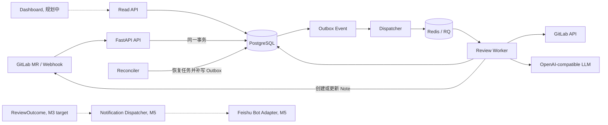
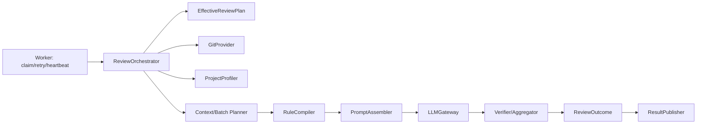

# GitLab MR AI Code Review 设计总览与里程碑计划

> 文档定位：项目设计、当前事实和建设计划的主入口。
>
> 状态基线：2026-08-05，以当前仓库代码、数据库迁移和自动化测试为准。
>
> 状态定义：`功能已实现` 表示已有代码和自动化测试支撑；`系统验收待补` 表示尚未通过对应真实依赖或现场环境验证；`规划中` 表示尚无可运行实现。

## 1. 总体结论

当前项目已经完成私有化 GitLab MR AI Code Review 的最小闭环，以及事务 Outbox、Dispatcher、Redis/RQ、Worker 原子领取和 Reconciler 补偿等可靠投递机制。

项目当前处于：

**M0 至 M2 功能实现完成，M2 隔离依赖和故障矩阵验收已通过；下一步进入 M3 评审质量与项目理解建设，企业 GitLab Staging 仍需按 M1 清单现场验收。**

现有系统已经能够：

1. 接收、认证、过滤并去重 GitLab Merge Request Webhook。
2. 在同一数据库事务中保存 WebhookEvent、ReviewJob 和 OutboxEvent。
3. 通过 Dispatcher、Redis/RQ 和 Worker 异步执行评审。
4. 拉取 MR、Diff 和变更文件的有限上下文。
5. 调用 OpenAI 兼容模型并解析结构化 Finding。
6. 确定性校验 Finding，保存 Finding 和 LLMRun。
7. 在 GitLab MR 中创建或更新汇总评论。
8. 对重复事件、并发入队、重复 Worker 消息和任务卡死执行幂等或补偿。
9. 通过只读 API 查询项目、任务和 Finding。

当前最重要的问题已经不是“能否调用 LLM”，而是：

- 模型是否真正理解项目结构、框架约定和开发范式。
- 哪些规则对哪些文件生效，是否可解释、可复现、可回滚。
- Prompt 或模型变化后，质量是提升还是退化。
- 大 MR 是否完整覆盖，部分失败是否会被误报为成功。
- 真实 Redis、PostgreSQL、GitLab 和进程崩溃下是否仍不丢任务、不重复评论。

因此后续顺序确定为：

**安全可复现基线 -> 最小项目理解 -> 规则与 Prompt 编译 -> 大 MR 分批 -> 质量与系统验收 -> 可观测试点 -> 反馈和企业治理。**

## 2. 产品定位与边界

### 2.1 产品目标

- 面向私有 GitLab 部署，代码和评审数据只进入组织允许的网络和模型边界。
- 自动评审 MR，优先发现正确性、安全性、可靠性和 API 兼容性问题。
- 输出低噪声、可定位、有证据、可执行的建议，而不是风格偏好汇总。
- 支持通用项目接入，同时允许按项目、语言、框架和路径应用不同规则。
- 输出可追溯、可复现、可去重的 Finding 和 GitLab 评论。
- 外部依赖短时异常时可恢复，不能因队列或发布重试产生重复业务结果。

### 2.2 “通用型”的准确含义

通用型不等于对所有文件后缀具有同等评审质量。项目采用两层能力：

1. **通用核心：** GitLab 接入、Diff、任务状态、结构化输出、Verifier、规则契约、Prompt 契约和发布机制与语言无关。
2. **生态画像：** 项目结构、框架惯例、模块边界、测试约定和专项规则按语言或框架逐步验证。

`supported_extensions` 只表示文件能够进入通用评审流程，不代表该语言已经通过质量认证。M3 起维护能力矩阵：

- `validated`：有 Golden Dataset 和真实项目试点数据。
- `experimental`：可使用通用规则，但没有足够质量样本。
- `unsupported`：明确跳过并给出原因。

在 M3 质量基线完成前，不对任何语言宣称已达到生产质量门槛。

### 2.3 核心用户

| 用户 | 首要诉求 | 主要入口 |
|---|---|---|
| 开发者 | 在 MR 中获得少而准、可定位、可操作的意见 | GitLab MR |
| 项目管理员 | 控制项目开关、规则、预算和试点范围 | CLI，后续管理界面 |
| 平台运维/质量负责人 | 排查任务、观察成本、评估质量和治理配置 | Read API，后续 Dashboard |

### 2.4 当前不纳入范围

- 不继续维护或直接迭代原开源项目，原项目只作为迁移参考。
- 暂不支持 GitHub、Gitea、Push 和定时全仓扫描。
- MVP 不将 AI 结果作为强制合并门禁。
- 暂不执行仓库任意脚本，不提供无隔离的 Agent 自主执行。
- 暂不建设向量数据库、全仓 RAG、通用 Symbol Graph 或多 Agent 编排。

## 3. 当前架构与演进判断

### 3.1 当前运行架构



当前部署采用模块化单体，API、Dispatcher、Worker、Reconciler 是独立进程，共享同一个代码库、领域模型和 PostgreSQL。

该部署架构能够支撑 M3 至 M5，不需要拆微服务。需要调整的是 Worker 内部职责，而不是增加新的网络服务。

### 3.2 当前架构适配性

| 方面 | 判断 | 处理方式 |
|---|---|---|
| 事务与异步投递 | Outbox 和原子领取方向正确 | 保持现状，补真实依赖和崩溃测试 |
| 外部适配器 | GitLabClient、LLM Adapter 已独立成模块 | 补稳定 Port/Protocol，方便组件测试 |
| Worker 职责 | 同时负责配置、GitLab、Context、LLM、存储和发布，继续扩展会失控 | M3 抽出应用级 ReviewOrchestrator，Worker 只保留任务生命周期和重试 |
| 配置快照 | ReviewJob 已保存快照，但 Worker 实际使用当前 ProjectConfig | M3.0 改为快照驱动，禁止旧任务读取可变配置 |
| Rule/Prompt | 配置字段已预留，但无 Rule Compiler；Prompt 硬编码在 LLM Adapter | M3 建立纯函数 Catalog、Compiler 和 PromptAssembler |
| 项目理解 | 只有 Diff 和变更文件新增行附近片段 | M3 增加受控 ProjectProfile 和 ContextManifest |
| 通知渠道 | 当前只有 GitLab Note，没有通用通知边界 | M3 保留 `NotificationPort`，M5 以 Feishu 适配器接入，不把通知逻辑放入 Worker 核心 |
| Dashboard | 当前无 Web，查询 API 也不是完整 Read Model | M4 先稳定 Read Model，再做最小治理界面 |

### 3.3 M3 内部目标边界



职责约束：

- `ReviewOrchestrator` 只编排一次评审，不包含队列和 HTTP 路由。
- `ProjectProfiler` 只读取允许的项目事实和规范，不调用 LLM。
- `Context/Batch Planner` 只选择和分组上下文，不决定是否发布。
- `RuleCompiler` 是确定性纯逻辑，不访问 GitLab、数据库和 LLM。
- `PromptAssembler` 不访问外部系统，只消费已解析的数据结构。
- `Verifier/Aggregator` 不执行网络 I/O。
- Port 只放在 GitLab、LLM、持久化、发布和通知等外部边界，不为每个内部函数创建接口。

这是一项模块内重构，不新增微服务、消息中间件或通用工作流引擎。

## 4. 技术与数据基线

### 4.1 技术栈

| 层次 | 技术选型 |
|---|---|
| 运行环境 | Python 3.12 |
| API | FastAPI、Pydantic、Uvicorn |
| 数据访问 | SQLAlchemy 2、Alembic |
| 数据库 | PostgreSQL 16 |
| 队列 | Redis 7、RQ |
| HTTP 客户端 | HTTPX |
| LLM 接入 | OpenAI-compatible Chat Completions API |
| 部署 | Docker Compose，独立 API/Dispatcher/Worker/Reconciler 进程 |
| 测试与质量 | Pytest、Ruff |

### 4.2 当前数据模型

当前共有 7 张业务表，不包含 Alembic 版本表：

| 表 | 作用 | 主要关系 |
|---|---|---|
| `projects` | GitLab 项目和凭据引用 | 1:N 关联配置、Webhook、任务 |
| `project_configs` | 项目当前配置 | N:1 关联项目 |
| `webhook_events` | Webhook 去重和审计信息 | N:1 关联项目，1:N 关联任务 |
| `review_jobs` | 一次 MR 评审任务及状态机 | N:1 关联项目和事件，1:N 关联运行数据 |
| `outbox_events` | 可靠投递事件 | N:1 关联 ReviewJob |
| `findings` | 结构化问题和稳定指纹 | N:1 关联 ReviewJob |
| `llm_runs` | 模型、请求哈希、耗时、Token 和错误 | N:1 关联 ReviewJob |

M3 首选复用 `review_jobs.config_snapshot` 保存 EffectiveReviewPlan，不立即建立 Prompt/Rule Registry 数据库表。只有管理界面和独立批次恢复成为真实需求时，才增加相应表。

## 5. 当前实现盘点

### 5.1 已实现能力

#### 私有化和工程运行基线

- 项目与参考开源实现解耦，按私有化平台独立演进。
- 全项目使用 Python 3.12。
- 提供 Docker Compose 和 Alembic 迁移。
- API、Dispatcher、Worker、Reconciler 可独立部署。
- 凭据通过环境变量或文件引用注入。

#### GitLab 接入

- CLI 注册和查询 GitLab 项目。
- 校验 Webhook Secret、事件类型和请求体大小。
- 忽略 Draft MR 和不支持的 MR 动作。
- 持久化脱敏 Payload，不保存请求头 Secret。
- 按 Delivery ID 和项目、MR IID、Head SHA 组合去重。
- 支持 TLS、自签名 CA、超时、限次重试和 Retry-After。
- 拉取 MR、Changes、Diff 和必要文件内容。

#### 评审引擎

- 解析 Diff 新增行，按扩展名、忽略路径、风险和字符预算筛选。
- 支持 `simple_context` 和 `diff_only`。
- 固定系统 Prompt 和结构化 JSON 输出。
- 解析失败时允许一次只修复格式的请求。
- 校验文件、置信度、新增行和字面证据。
- 生成 Fingerprint 并过滤单任务重复问题。
- 保存 Finding、LLMRun、结果、错误和 Token 使用量。
- 创建或更新带稳定标记的 GitLab 汇总 Note。

#### 可靠性和查询

- API 事务写入 `WebhookEvent + ReviewJob + OutboxEvent`。
- Dispatcher 数据库领取和 Redis 短时投递锁。
- Worker 原子领取，重复队列消息不能并发执行同一任务。
- Reconciler 恢复超时 running，并补偿超过宽限期的 queued。
- Note 写入失败后可以复用已保存 Markdown，只重试发布阶段。
- 健康检查、项目、ReviewJob 和 Finding 只读 API。
- 生产模式下使用独立 `API_BEARER_TOKEN` 保护查询 API。

### 5.2 已知事实缺口

| 能力 | 当前事实 | 风险 |
|---|---|---|
| 配置快照 | 已保存快照，但执行使用当前 `project.config` | 入队后配置变化会改变旧任务，无法复现 |
| Prompt 版本 | `prompt_version` 固定为 `mvp-v1`，Prompt 是代码常量 | 版本号与真实内容可能不一致，请求哈希也未覆盖完整 Prompt |
| 规则 | `enabled_rules` 只是字符串列表，`path_rules` 未执行 | 模型可忽略规则或自造 `rule_id`，规则指标不可信 |
| 项目理解 | 只取变更文件新增行附近片段 | 不理解模块边界、测试约定、公共 API 和框架范式 |
| Head 校验 | LLM 前校验一次，发布前不再校验 | LLM 执行期间有新 Push 时可能发布旧结果 |
| Note 生命周期 | Marker 包含 Job 和 Head，每个新 Head 默认产生新 Note | 连续 Push 可能造成 MR 评论噪声 |
| Token 预算 | 使用字符数除以 4 的估算 | 不同模型偏差较大，只能作为保守预算 |
| 语言质量 | 支持多个扩展名 | 尚无按语言划分的质量基线 |

### 5.3 当前测试证据边界

基础 Pytest 测试已通过，覆盖 Webhook、API 去重、API/Reconciler 竞态、Worker 原子领取和心跳、Outbox、Redis 锁 Fake、LLM JSON 修复、GitLab Note Mock、Context 和 Verifier 基础行为。新增的 M2 集成套件使用独立 PostgreSQL 16 和 Redis 7，覆盖 20 并发 Webhook、双 Dispatcher、双 Worker、Redis 丢失/锁过期、Dispatcher 崩溃、Worker 四阶段崩溃和 Note POST 响应超时。

基础测试仍使用 SQLite、Mock 或 Fake；M2 集成套件已覆盖以下真实依赖和故障注入边界：

- PostgreSQL `FOR UPDATE SKIP LOCKED` 并发语义。
- 真实 Redis/RQ、锁过期、RQ Job 丢失和 Redis 清空恢复。
- 多 Dispatcher、多 Worker 和进程崩溃点。
- GitLab Note POST 成功后超时的 Mock 契约；GitLab Staging 的分页、限流、CA 和真实网络契约仍待现场验证。

仍未覆盖：

- 配置快照执行、发布前 Head 竞态和 Prompt Injection。
- Golden Dataset 和按语言质量回归。

因此 M0 至 M2 的准确状态是“功能实现完成；M2 隔离依赖验收通过，M1 的企业 GitLab Staging 现场验收和 M0 发布治理仍待补”。

## 6. 里程碑总览

| 里程碑 | 当前状态 | 核心目标 | 退出条件摘要 |
|---|---|---|---|
| M0 私有化运行基线 | 功能已实现，治理待补 | 统一运行时、存储、部署和配置 | CI、许可证、内部 CA 和发布治理在试点前补齐 |
| M1 最小评审闭环 | 功能已实现，系统验收待补 | Webhook 到 GitLab 评论可用 | 真实 GitLab Staging 契约通过 |
| M2 可靠投递与幂等 | 功能已实现，隔离依赖验收通过 | 至少一次投递下不丢任务、不重复业务结果 | PostgreSQL/Redis/崩溃矩阵已通过；生产容量和现场网络仍需验证 |
| M3 项目理解和质量基线 | 下一阶段 | 可复现计划、项目画像、规则 Prompt、大 MR 和评测 | 两个试点生态通过离线及 Shadow 门禁 |
| M4 可观测试点 | 规划中 | 真实项目持续运行且可诊断、可度量 | 至少 14 天和 100 个 eligible 事件 |
| M5 反馈与企业治理 | 规划中 | 多项目运营、权限、审计和配置治理 | 权限、反馈、备份和升级验收通过 |
| M6 高级评审 | 条件规划 | 行级评论、跨文件索引、Agent 和门禁 | 由质量和成本数据单独立项 |

## 7. 里程碑详细规划

### M0 私有化运行基线

已实现：

1. Python 3.12 运行时和依赖约束。
2. FastAPI、Dispatcher、Worker、Reconciler 入口。
3. PostgreSQL、Redis、Alembic 和 Docker Compose。
4. 统一配置、结构化日志和健康检查。
5. 核心数据实体和迁移。

试点前仍需完成：

1. CI 中固定执行 Ruff、Pytest、迁移升级和依赖扫描。
2. 分支保护、CODEOWNERS 和发布责任人。
3. 迁移来源、依赖许可证和发布制品的正式扫描。
4. 使用企业内部 CA 和网络策略的 Staging 部署验证。
5. 基础升级、回滚和数据库备份操作手册。

验收至少包括：真实 PostgreSQL 连续执行两次 `alembic upgrade head`；Docker Compose 中 API、Dispatcher、Worker、Reconciler 全部进入预期运行状态；Secret Scan 不发现真实凭据。

### M1 最小评审闭环

已实现：项目注册、Webhook 验证和去重、GitLab 数据拉取、有限 Context、LLM 结构化输出、Verifier、Finding、LLMRun、汇总 Note 和只读 API。

系统验收补充：

1. 使用企业 GitLab Staging 验证 open、update、reopen、draft、关闭和快速连续 Push。
2. 验证自签名 CA、Token 失效、404、429、5xx、分页和 Diff Overflow。
3. 验证创建 Note、更新 Note、创建成功但客户端超时后的恢复。
4. 明确同一 MR 多个 Head 的评论生命周期。

默认产品决策：M3 起每个 MR 维护一条“当前 AI 评审”滚动 Note，历史结果保留在数据库；旧 Head 结果不得覆盖新 Head。若后续选择每 Head 一条 Note，必须增加过期标识和数量上限。

### M2 可靠投递与幂等

已实现：事务 Outbox、Dispatcher、Redis 投递锁、Worker 原子领取和持续心跳、Reconciler 宽限期、状态恢复、Finding 唯一约束、Note Marker Upsert，以及 LLM 调用前后的审计落库。

交付语义必须准确表达：

| 对象 | 语义 | 说明 |
|---|---|---|
| Outbox 和 RQ 消息 | 至少一次 | 崩溃恢复可能产生重复消息 |
| 同一时刻的 ReviewJob 执行 | 单 Worker 领取 | 原子状态更新阻止并发重复执行 |
| Finding | 最终幂等 | ReviewJob + Fingerprint 唯一约束 |
| GitLab Note | 最终幂等目标已覆盖 | 创建 POST 单次尝试；结果不确定时先按 Marker 对账，再决定是否重试 |
| LLM 调用 | 可能至少一次 | 调用前写入 `running`，模型返回后立即记录每次调用和 Token；进程硬崩溃造成的未知结果标记为 `unknown`，重试不隐藏成本 |

M2 系统验收矩阵：

1. PostgreSQL 下 20 个并发 Webhook、2 个 Dispatcher、2 个 Worker。
2. Dispatcher 在 Redis Enqueue 成功后、Outbox 标记完成前崩溃。
3. Redis 锁过期、RQ Job 丢失、Redis 清空后从 PostgreSQL 恢复。
4. Worker 在领取后、LLM 后、结果保存后、Note 后分别崩溃。
5. GitLab Note POST 成功但响应超时后，不产生重复 Note。
6. 每次发起 LLM 请求均创建 `LLMRun`；已获得的 Token 立即落库，无法确定结果的硬崩溃窗口标记为 `unknown`，不能隐藏重复调用成本。

验收门槛：已接收事件最终进入终态；同项目、MR、Head 不产生重复当前评论；Finding 不重复；所有不可恢复失败具有稳定错误码和处理说明。

M2 集成验收命令（独立 PostgreSQL/Redis，不接触开发数据）：

```bash
docker compose -f docker-compose.m2.yml up -d --wait
M2_INTEGRATION=1 .venv/bin/pytest tests/integration/m2 -m m2_integration
docker compose -f docker-compose.m2.yml down
```

测试夹具会连续执行两次 `alembic upgrade head`，每个用例清空业务表和 Redis 数据；未设置 `M2_INTEGRATION=1` 时该套件自动跳过。

### M3 项目理解、规则 Prompt 和质量基线

M3 保持模块化单体，参考 3 个两周迭代。评测从第一天开始，不等所有功能完成后再补。

#### M3.0 安全、可复现和评测起点

所需功能：

1. 定义不可变 `EffectiveReviewPlan`，包含模型别名、Prompt/Schema 版本、规则版本、预算、阈值、数据策略、ProjectProfile 来源和内容哈希。
2. ReviewJob 创建时冻结平台配置；Worker 不再读取可变 ProjectConfig 决定旧任务行为。
3. 首次执行在调用 LLM 前固化完整 Plan；重试必须复用同一 Plan。
4. 请求哈希覆盖完整 Prompt Envelope，而不只是 Context JSON。
5. 在发布 GitLab Note 前再次读取 MR Head SHA；Head 变化时保存诊断但不回写旧结果。
6. 提供 `shadow` 发布策略，完整执行并持久化，但 ResultPublisher 不写 GitLab。
7. 建立 10 至 20 个已裁决 MR 的种子集，只用于打通评测工具，不作为最终质量门禁。
8. 将 Worker 中的评审编排抽入 ReviewOrchestrator，保留现有进程和部署方式。

容错规则：

- Catalog 版本不存在属于永久配置错误，调用 LLM 前失败。
- Optional Profile 文件缺失时降级到通用画像并记录 limitation。
- 必选安全策略无法解析时 Fail Closed，不使用猜测默认值。
- Shadow 模式下任何路径都不得调用 GitLab Writer。

验收门槛：

- v1 任务入队后项目配置改为 v2，旧任务及重试仍使用 v1，新任务使用 v2。
- 相同任务重试生成相同 Plan Hash 和请求哈希。
- LLM 执行期间 Head 变化时，GitLab Note 写入为 0。
- Shadow 任务保存结果，但 GitLab Writer 调用为 0。
- ReviewOrchestrator 可以用 Fake Port 做组件测试。

#### M3.1 最小 ProjectProfile 和 ContextManifest

目标不是建立全仓索引，而是给模型一份小而可信、可追溯的项目画像。

`ProjectProfile` 最小内容：

1. 检测到的语言、框架和包管理清单，并附来源文件。
2. Workspace/模块根、源码目录、测试目录和生成目录。
3. 构建、测试、Lint 的配置入口，只描述不执行。
4. 公共 API/导出入口和项目配置指定的关键路径。
5. 项目负责人批准的架构、编码和测试规范文件。
6. 每项内容的 source ref、文件路径、content hash、可信级别和字符预算。

读取边界：

- 项目规范和 `.ai-review.yml` 只能从目标分支或可信默认分支读取。
- MR source/head 中对规则、AGENTS.md、Prompt 或配置的修改只作为待审查代码，不能改变本次系统行为。
- 平台维护不可覆盖的安全策略、字段白名单和最大预算。
- ProjectProfile 中的仓库文本仍标记为不可信数据，不能进入 System Prompt 权限层。

`ContextManifest` 必须记录每个文件：

- `reviewed | skipped | failed`。
- `diff | changed_file | related_file | project_profile` 来源。
- `ignored_path | unsupported | binary | too_large | token_budget | fetch_failed` 等稳定 reason code。
- 选择原因、批次和使用预算。

首版相关文件选择只做确定性、低成本机制：同模块文件、同名测试、配置指定的 companion pattern、公共导出入口和模块规范。语言级 import/symbol 扩展按试点数据增加，不建设通用 Symbol Graph。

验收门槛：

- 至少用 4 类 Fixture 项目验证单仓、多包、前后端混合和后端服务布局。
- Profile 大小、文件数量和单文件长度均有硬上限。
- Profile 缺失不会静默伪造成已理解项目，GitLab Coverage 明确显示降级。
- 恶意 MR 修改配置或规范文件不能改变本次有效规则和 Prompt。

#### M3.2 Rule Catalog、Compiler 和 PromptAssembler

首版采用 Git 版本化 Catalog，不建设数据库 Registry、通用规则 DSL 或 Prompt 可视化编辑器。

规则职责分开处理：文件选择、忽略和预算属于确定性 Policy；需要语义判断的检查项才进入 LLM Rule；未来 Linter/SAST 结果通过统一 Finding 契约接入，不让 LLM 重做确定性工具已经完成的工作。

Rule 最小字段：

| 字段 | 说明 |
|---|---|
| `rule_id`、`version` | 稳定身份，发布后不可原地修改 |
| `category` | correctness/security/reliability 等受控枚举 |
| `languages/frameworks` | 适用生态，可为空表示通用 |
| `include_paths/exclude_paths` | 文件匹配范围 |
| `objective` | 要检查的问题和影响 |
| `trigger/evidence` | 触发条件和必须提供的证据 |
| `do_not_report` | 反例、例外和禁止产生的噪声 |
| `severity_guidance` | 严重级别判断依据，不直接替模型证明问题成立 |

规则编译顺序：

1. 加载不可关闭的系统安全约束。
2. 加载平台批准的 Rule Catalog 版本。
3. 应用项目启停、语言/框架和 include/exclude path。
4. 应用可信目标/默认分支中白名单配置。
5. 最后执行平台 allowlist、数量和 Token 上限钳制。

MR 标题、描述、评论和 source branch 文件永远不能作为配置层。

Compiler 输出每个文件或 Batch 的规则 ID、版本、匹配原因、排除原因和 Canonical Hash，并提供 CLI 预览：给定项目和文件路径即可查看最终规则，不调用 LLM。

Prompt Envelope 固定分层：

1. 不可覆盖的 System Safety、信任边界和禁止事项。
2. 输出 JSON Schema、Severity 和 Finding Scope 契约。
3. 版本化 Reviewer Policy。
4. 已编译的适用规则。
5. ProjectProfile，明确标记为不可信项目数据。
6. MR 元数据、Diff 和代码上下文，明确标记为不可信数据。

不允许项目提供任意 System Prompt，不将所有规则塞入每个 Batch，不要求模型重做已有 Lint。Prompt 只要求输出结论、证据和建议，不保存或要求输出思维链。

Finding 契约补充：

- M3 后 `rule_id` 必填，必须属于本批 Effective Rules；未知或禁用 ID 由 Verifier 拒绝。
- 提供受控的通用 fallback Rule ID，不接受模型自由发明 ID。
- `scope` 区分 `diff_line | changed_file | mr`；只有 `diff_line` 可以进入后续行级评论。
- 文件级或 MR 级问题必须提供来自已给上下文的证据和影响链。

验收门槛：

- Rule Schema、Glob、优先级、禁用、冲突、Canonical Sort 和 Hash 有纯单元测试。
- 同一 Plan 和输入生成字节级稳定的 Prompt Envelope。
- 未匹配、已禁用或模型自造的 Rule ID 不得发布。
- Prompt Injection Fixture 不得改变输出 Schema、规则集合、模型端点或发布策略。
- 固定响应的结构化契约测试 100% 通过。

#### M3.3 大 MR 分批、聚合和质量门禁

所需功能：

1. Context Planner 按模块、文件关联和适用规则形成有限 ReviewBatch。
2. 每批不超过输入预算；单 MR 同时具有批次数、总 Token、总耗时和总重试上限。
3. 每批记录 LLMRun、Batch Key、Prompt Hash、Token、耗时和失败原因。
4. Aggregator 只做 Verifier、Fingerprint 去重、稳定排序和 Coverage 汇总，不重新生成问题。
5. 单批永久失败时允许其他批次完成，ReviewOutcome 标记 `partial` 并公开失败文件。
6. 预算耗尽后停止创建新调用，不把未评审文件算作 reviewed。
7. 将 Golden Dataset 扩展到至少 50 个 MR，覆盖两个试点主生态、至少 60 个已标注缺陷、至少 15 个 Clean MR，以及至少 10 个恶意输入或预算边界 MR。

为避免过度设计，首版 Batch 在单 ReviewJob 内执行。进程崩溃后允许整个任务重试并重复部分 LLM 调用，不承诺只恢复失败批次。只有重复成本或长任务失败率达到明确阈值时，才增加 `review_batches` 表和独立恢复状态机。

评测口径：

- 数据集划分调优集和封存 Holdout，禁止用 Holdout 调 Prompt 后继续声称独立评测。
- Finding 匹配至少使用 `rule_id + file + 允许行范围`。
- 检出、定位、Severity、证据有效性分别计分。
- Recall 只在具有已标注缺陷的样本上计算；普通线上 MR 只计算接受率和误报反馈。
- 样本量不足时只报告原始分子/分母，不输出误导性的百分比达标结论。

M3 建议退出门槛：

| 指标 | 门槛 |
|---|---|
| 最终 Schema 解析 | 累计至少 100 个 Batch 响应，允许一次 Repair 后 100% 可解析 |
| 未验证原始输出发布 | 0 |
| 注入导致越权或写操作 | 至少 20 个对抗样本，0 次 |
| Eligible 文件覆盖 | 100% 进入 Batch 或具有稳定 reason code |
| Publishable Precision | 建议不低于 75%，且至少 40 条 Finding |
| High/Critical Precision | 建议不低于 85%；分母不足 20 时标记样本不足 |
| 已标注缺陷 Recall | 建议不低于 60%，且至少 40 个已标注缺陷参与计算 |
| Clean MR 零噪声率 | 建议不低于 80%，且至少 15 个 Clean MR |
| Shadow | 至少 2 个项目、20 个真实 MR，GitLab Writer 0 次 |

质量数值是试点初始建议，不是行业基准；正式阈值由项目负责人、测试和业务评审人共同批准。

### M4 可观测性和项目试点

#### M4.0 Read Model 和访问边界

先稳定后端展示契约，再开发前端。Read Model 至少区分：

| 维度 | 对外含义 |
|---|---|
| Lifecycle | queued/running/succeeded/failed/skipped 和 current_stage |
| Coverage | full/partial/none，reviewed/skipped/failed 和 reason 聚合 |
| Publication | shadow/pending/published/failed/stale |
| Provenance | config、Prompt、Rule Set、模型别名、Context Strategy 版本 |
| Effective Config | 最终规则、配置来源、忽略/冲突原因和平台钳制结果 |
| Failure | error_code、stage、retryable、脱敏 message、request_id |
| Budget | Token 预算/使用量、耗时；费用只使用网关可信数据 |

前端不推导状态机、权限和费用；后端返回稳定枚举和 allowed actions。未知枚举不得导致页面白屏。

M4 默认只允许平台运维在受控网络中通过 Bearer Token 访问。若试点项目成员需要直接访问 Dashboard，最小 OIDC 和项目范围只读权限必须前移，不能共享平台 Token。

#### M4.1 指标、链路和告警

所需功能：

1. Webhook、Outbox、队列、任务、GitLab、LLM、Token、Finding 和 Note 指标。
2. 贯通 request_id、delivery_id、review_job_id、rq_job_id 和 llm_run_id。
3. Dispatcher、Worker、Reconciler 存活和停滞检测。
4. 技术成功率、Coverage、端到端时延、积压、错误和 Token Dashboard。
5. Outbox/队列积压、连续失败、任务卡死、预算耗尽和依赖异常告警。
6. 日志、Evidence 和模型数据的脱敏、保留期和清理策略。

#### M4.2 最小 Dashboard 和试点

最小页面：项目只读状态、Review 列表/详情、Finding 查询、Coverage/质量/可靠性/Token 概览。GitLab 仍是开发者处理评论的主界面，Dashboard 只承担平台治理。

M4 不提供 Dashboard 写操作。Kill Switch 先使用受控 CLI 或运维命令，界面只显示 effective 状态；配置、发布、回滚和启停按钮进入 M5。

完整 Feedback UI 不阻塞 M4。试点先通过固定抽样、Finding 导出和受控离线标注形成 accepted/false_positive/not_actionable 周报，M5 再做在线反馈闭环。

M4 退出门槛：

1. 连续运行至少 14 天，累计至少 100 个 eligible Webhook。
2. 丢任务定义为已持久化事件未在恢复窗口内进入终态，目标 0。
3. 同项目、MR、Head 的重复当前评论目标 0。
4. 技术成功率分母排除 ignored、draft、disabled 和 stale，并单独报告 full/partial coverage。
5. P95、成功率和错误率只在分母达到 100 后判断。
6. 每类关键告警至少故障注入一次，并在约定检测时间内触发。
7. 项目负责人确认评论噪声可接受后才扩大试点。

### M5 反馈闭环、企业治理和通知

#### M5.1 反馈与配置治理

所需功能：

1. Feedback 和 AuditLog 数据模型。
2. Finding 的确认、误报、忽略、已修复和备注。
3. 规则级接受率、误报率和项目反馈趋势。
4. 项目配置 Draft、Validate、Publish、Rollback 和差异审计。
5. 编译预览：给定文件路径展示有效规则、来源、冲突和钳制原因。
6. 带 Idempotency-Key、权限和限流的人工重跑。
7. 乐观锁或配置版本校验，冲突返回 409，防止覆盖他人修改。

配置界面首版只允许选择已审核的 Prompt Profile/Version 和受控规则字段，不提供任意 Raw Prompt 文本框、拖拽规则 DSL 或自动规则学习。

#### M5.2 企业通知：先接入飞书机器人

通知是评审结果的旁路消费者，不改变 GitLab MR 评审主链路。首个渠道选择飞书群机器人，后续再按实际需求增加邮件、企业微信等适配器。

所需功能：

1. 定义稳定的 `ReviewNotificationEvent`，至少覆盖 `review.completed`、`review.failed`、`review.stale` 和高严重级别 Finding 告警；事件只引用 `ReviewJob`、项目、MR 链接、状态、Coverage、Finding 计数、错误码和 Trace ID。
2. 增加 `NotificationPort` 和 `FeishuBotAdapter`。核心 ReviewOrchestrator 只产生结构化事件，不依赖飞书 SDK、HTTP 格式或卡片模板。
3. 复用现有 `outbox_events` 和 Dispatcher，按 `event_type` 路由到通知队列；不新增消息中间件。通知发送可以复用 Worker 运行单元，但必须与 GitLab Note 发布隔离重试和超时预算。
4. 支持项目/团队级启用开关、事件类型过滤和消息模板版本；机器人 Webhook 地址、签名 Secret 和租户信息只保存 Secret Manager 引用，不进入普通配置和日志。
5. 默认只发送摘要、严重级别、覆盖率、耗时和 GitLab 链接，不发送源码、Diff、模型完整响应或凭据。需要查看细节时跳转 GitLab 或受权限保护的 Read API。
6. 对通知采用至少一次投递语义，使用 `channel + target + event_type + review_job_id + outcome_version` 生成去重键；发送成功后记录投递结果和响应摘要。飞书接口没有端到端幂等保证时，不宣称 exactly-once，必须支持人工重试和重复通知排查。
7. 统一处理 TLS、连接/读取超时、限流、429/5xx、Retry-After、有界退避和熔断；飞书不可用不能阻塞 GitLab Note 或把 ReviewJob 改为失败。
8. 记录通知成功率、延迟、重试次数、积压、按渠道失败原因和脱敏请求 ID，并提供项目级 Kill Switch。

M5 通知验收：

- Review 完成、失败和 stale 事件在配置启用时可到达飞书，关闭时不产生外部请求。
- GitLab Note 成功而飞书失败时，ReviewJob 仍保持原状态，通知可独立补偿。
- 重复 Outbox/队列消息不会无限发送；同一事件的重复投递可通过去重键和审计记录定位。
- 飞书 401/403/429/5xx、超时、无效响应和 Secret 轮换均有契约测试与 Runbook。
- 消息不包含源码、完整 Prompt、模型原文和 Secret，跨项目链接和数据权限校验通过。

#### M5.3 身份、安全和生产交付

所需功能：

1. OIDC/SSO，以及管理员、平台运维、项目管理员和只读角色。
2. 项目级数据权限和所有写操作授权。
3. Secret Manager、Token 轮换和失效流程。
4. 网络策略、内部 CA、镜像签名、依赖扫描和制品清单。
5. 组织标准部署、离线镜像、升级和回滚手册。
6. PostgreSQL 备份恢复、Redis 故障策略和容量规划。
7. 明确 SLO、RPO、RTO、数据保留期和故障响应手册。

验收门槛：不能跨项目越权；敏感操作均可审计；完成备份恢复演练；版本可灰度和按时回滚。

### M6 高级评审能力

候选功能：

1. GitLab 行级 Discussion 创建、更新、Resolve 和过期定位。
2. 语言感知的 Symbol/调用关系和增量索引。
3. 对极少数关键规则使用第二阶段复核或不同模型复核。
4. 在严格隔离、只读文件系统、网络白名单和资源上限下运行 Agent 工具。
5. 将高置信且已验证规则映射为 Commit Status。
6. 探索合并门禁，默认 Fail Open，保留人工覆盖和紧急关闭。

进入条件：M3 质量稳定；M4/M5 已积累真实接受率和误报率；行级定位和高危准确率达到组织门槛；安全团队批准隔离方案。

## 8. 统一容错规则

| 场景 | 系统行为 | 是否发布 |
|---|---|---|
| 项目禁用、Draft、无支持文件 | skipped，记录原因 | 否或发布受控说明，按项目策略 |
| Catalog/Plan 无效 | 永久失败，LLM 调用为 0 | 否 |
| Optional ProjectProfile 文件失败 | 降级通用画像，记录 Coverage limitation | 可发布部分结果 |
| GitLab/LLM 429、5xx、Timeout | 有界退避，遵守 Retry-After 和总预算 | 成功后发布 |
| LLM 两次输出均无效 | 当前 Batch 失败，不发布原始文本 | 仅在其他 Batch 有效时发布 partial |
| 部分 Batch 失败或预算耗尽 | 保存有效 Finding，Coverage=partial | 是，必须公开限制 |
| 所有 Batch 失败 | ReviewJob failed | 否 |
| 发布前 Head 变化 | stale/skipped，保留诊断 | 否 |
| Note POST 结果不确定 | 先按 Marker 查询，再决定是否重试创建 | 目标为一条当前 Note |
| 数据库保存成功、Note 失败 | 复用已保存 Outcome，仅重试发布 | 重试成功后发布 |
| GitLab Note 成功、通知失败 | ReviewJob 保持原评审状态，通知事件独立退避重试 | 不阻塞 GitLab 结果 |
| 通知重复投递 | 使用渠道/目标/事件版本去重键并保留审计 | 不承诺第三方 exactly-once |
| 通知包含源码或 Secret | 事件构造层拒绝非允许字段，日志和模板脱敏 | 不发送 |

所有重试必须受最大次数、总时间和总 Token 预算约束。不得通过无限重试掩盖配置错误、认证错误或模型不兼容。

## 9. 全局完成定义

每个新增能力只有同时满足以下条件才算完成：

1. 有明确的输入、输出、版本和失败契约。
2. 数据库变更包含 Alembic 迁移、兼容和回滚说明。
3. 覆盖正常、重复、超时、重试、预算耗尽和权限失败。
4. 状态、幂等键和补偿边界经过真实依赖或故障注入测试。
5. 日志可通过 ReviewJob ID 追踪，且不泄露 Token、Secret 和非必要源码。
6. 有指标、稳定错误码和运维处理方式。
7. Prompt/Rule/Model 变化通过离线基线和 Shadow 门禁。
8. 更新设计、部署和操作文档。
9. 通过 Ruff、Pytest、迁移和对应集成测试。

## 10. 关键风险与控制策略

| 风险 | 影响 | 控制策略 |
|---|---|---|
| 模型不理解项目范式 | 高 | ProjectProfile、相关文件、生态能力矩阵和人工批准规范 |
| 规则过多导致注意力稀释 | 高 | 按文件确定性匹配、规则 Token 上限和编译预览 |
| 仓库内容 Prompt Injection | 高 | 可信分支、字段白名单、分层 Prompt、数据标记和对抗测试 |
| Prompt/模型升级静默退化 | 高 | 不可变版本、完整 Hash、Holdout、Shadow 和回滚 |
| 大 MR 静默漏审 | 高 | Batch、ContextManifest、Coverage reason 和总预算 |
| 旧 Head 结果污染新 MR | 高 | 发布前二次校验和滚动 Note |
| 消息重放或补偿重复执行 | 已基本控制 | Outbox、原子领取、Fingerprint 和 Note Upsert |
| LLM 重复调用增加成本 | 中 | 承认至少一次语义，记录每次调用和总预算 |
| 源码或凭据泄露 | 高 | 私有部署、TLS、凭据引用、脱敏、RBAC 和保留期 |
| AI 错误阻断合并 | 高 | Shadow/非阻断先行，门禁延后且默认 Fail Open |

## 11. 防止过度设计

当前明确采用：

- 模块化单体和现有四个运行进程。
- Git 版本化 Prompt/Rule Catalog。
- 小型、受控、带来源的 ProjectProfile。
- 单 ReviewJob 内分批和确定性聚合。
- GitLab MR 作为开发者工作台，Dashboard 作为治理台。

没有数据证明前不建设：

- Prompt/Rule 数据库 Registry 和可视化流程编排器。
- 通用规则 DSL、组织级复杂继承和自动规则学习。
- ReviewBatch 独立状态机和通用工作流引擎。
- 向量数据库、全仓 RAG、通用 Symbol Graph。
- 多 Agent、多模型默认复核和 Agent 控制台。
- 微服务拆分、跨 Git Provider UI 和财务级计费。

触发新增复杂度的条件必须是可观测问题，例如重复 Batch 成本、Profile 拉取时延、数据库瓶颈或明确的跨团队独立发布需求，而不是预判未来可能需要。

## 12. 建议执行顺序

下一阶段按三个迭代推进：

1. **迭代一：M3.0 + M3.1。** 修复快照执行和 Head 竞态，抽 ReviewOrchestrator，建立 Seed Dataset、Shadow、ProjectProfile 和 ContextManifest。
2. **迭代二：M3.2。** 建立文件型 Rule/Prompt Catalog、Compiler、PromptAssembler、Rule ID 验证和注入测试。
3. **迭代三：M3.3。** 建立 Batch/Aggregator、Coverage、50 个 MR 数据集、Holdout 和两个项目 Shadow 验证。

M3 退出后补 M0 至 M2 的真实依赖系统验收，再进入 M4 真实项目试点。Dashboard 不先于质量、Read Model 和访问边界建设。

## 13. 可核验参考与借鉴边界

| 项目 | 可借鉴机制 | 本项目不照搬的部分 |
|---|---|---|
| [Alibaba OpenCodeReview](https://github.com/alibaba/open-code-review) | 确定性文件选择/分组/规则匹配与 LLM 动态分析分工，使用 Precision/Recall/F1/Token/Time 评估 | 当前不引入 Agent Tool、多 Agent 或其完整规则体系 |
| [OpenCodeReview Rule Skill](https://github.com/alibaba/open-code-review/blob/main/skills/open-code-review/SKILL.md) | 路径规则、规则优先级和 `rules check` 预览思路 | 不采用任意外部规则文件和通用 DSL |
| [Qodo PR-Agent](https://github.com/The-PR-Agent/pr-agent) | GitLab Webhook、默认分支配置、受限 Repo Context、结构化 Prompt 和大 Patch 处理 | 不复制多工具产品形态和全部配置项 |
| [PR-Agent Dynamic Context](https://github.com/The-PR-Agent/pr-agent/blob/main/docs/docs/core-abilities/dynamic_context.md) | 按函数/类等结构边界扩展上下文，而不是只做固定长度截断 | M3 先做低成本 companion pattern，语言 AST 按数据引入 |
| [reviewdog](https://github.com/reviewdog/reviewdog) | added/diff_context/file 等定位范围和 GitLab Reporter 约束 | M3 不执行仓库 Linter，未来只考虑统一 Finding 契约 |

借鉴仅限可验证的机制和设计思想，不直接复制代码、阈值或架构规模。引入任何代码前仍需完成许可证和安全审查。

## 14. 文档关系

- 本文负责当前事实、目标架构、优先级和里程碑验收。
- `ARCHITECTURE.md` 负责组件边界、调用链和可靠性设计。
- `DATABASE_API.md` 负责数据库字段、索引和 API 契约。
- `REVIEW_ENGINE.md` 负责 Context、Prompt、Rule、Verifier 和渲染设计。
- `SECURITY.md` 负责威胁模型、认证、权限和数据安全。
- `DEPLOYMENT.md` 负责部署拓扑、配置、可观测性和运维。
- `MIGRATION.md` 负责参考项目能力迁移和代码归属。
- `ROADMAP.md` 保留历史工作包；状态与本文冲突时，以本文和实际代码为准。
